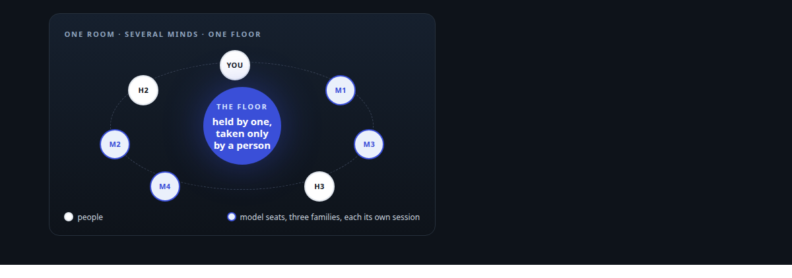
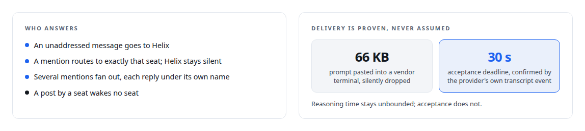
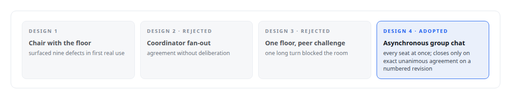
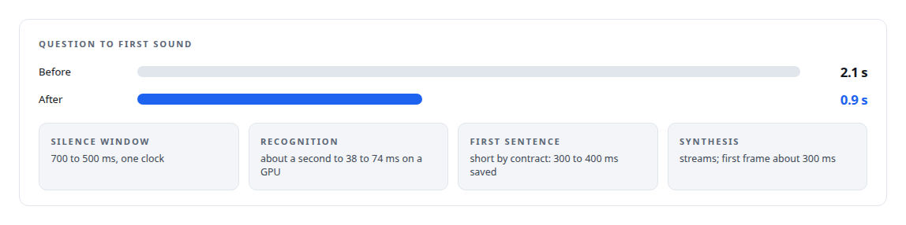

# Helix

**Humans and several AI minds in one room, and one colleague who can be reached wherever the work is: in team chat, by voice, and in a Teams call**

Canonical: https://coreyjames.ai/systems/helix/  
Author: Corey James · Published: 2026-10-28 · Kind: system  
Technologies: [Applied cryptography](https://github.com/coreyjames-ai/portfolio/tree/main/technologies/applied-cryptography) · [Axum](https://github.com/coreyjames-ai/portfolio/tree/main/technologies/axum) · [Bash](https://github.com/coreyjames-ai/portfolio/tree/main/technologies/bash) · [Binary wire protocol design](https://github.com/coreyjames-ai/portfolio/tree/main/technologies/binary-wire-protocol-design) · [Budget enforcement and cost governance](https://github.com/coreyjames-ai/portfolio/tree/main/technologies/budget-enforcement-and-cost-governance) · [C#](https://github.com/coreyjames-ai/portfolio/tree/main/technologies/c-sharp) · [Cloudflare Tunnel](https://github.com/coreyjames-ai/portfolio/tree/main/technologies/cloudflare-tunnel) · [Context engineering and persistent agent memory](https://github.com/coreyjames-ai/portfolio/tree/main/technologies/context-engineering-and-persistent-agent-memory) · [Conversational turn-taking and barge-in](https://github.com/coreyjames-ai/portfolio/tree/main/technologies/conversational-turn-taking-and-barge-in) · [Docker](https://github.com/coreyjames-ai/portfolio/tree/main/technologies/docker) · [Evidence-gated acceptance](https://github.com/coreyjames-ai/portfolio/tree/main/technologies/evidence-gated-acceptance) · [FFmpeg](https://github.com/coreyjames-ai/portfolio/tree/main/technologies/ffmpeg) · [GPU admission control and co-residency](https://github.com/coreyjames-ai/portfolio/tree/main/technologies/gpu-admission-control-and-co-residency) · [H.264](https://github.com/coreyjames-ai/portfolio/tree/main/technologies/h-264) · [Hugging Face Hub](https://github.com/coreyjames-ai/portfolio/tree/main/technologies/hugging-face-hub) · [Idempotency, exactly-once effects and crash recovery](https://github.com/coreyjames-ai/portfolio/tree/main/technologies/idempotency-exactly-once-effects-and-crash-recovery) · [Identity and access management for AI agents](https://github.com/coreyjames-ai/portfolio/tree/main/technologies/identity-and-access-management-for-ai-agents) · [Intel Arc GPUs](https://github.com/coreyjames-ai/portfolio/tree/main/technologies/intel-arc-gpus) · [JavaScript](https://github.com/coreyjames-ai/portfolio/tree/main/technologies/javascript) · [MCP tool design](https://github.com/coreyjames-ai/portfolio/tree/main/technologies/mcp-tool-design) · [Mattermost](https://github.com/coreyjames-ai/portfolio/tree/main/technologies/mattermost) · [Microsoft Agent 365](https://github.com/coreyjames-ai/portfolio/tree/main/technologies/microsoft-agent-365) · [Microsoft Azure](https://github.com/coreyjames-ai/portfolio/tree/main/technologies/microsoft-azure) · [Microsoft Entra ID](https://github.com/coreyjames-ai/portfolio/tree/main/technologies/microsoft-entra-id) · [Microsoft Graph](https://github.com/coreyjames-ai/portfolio/tree/main/technologies/microsoft-graph) · [Microsoft Teams](https://github.com/coreyjames-ai/portfolio/tree/main/technologies/microsoft-teams) · [Microsoft real-time media SDK](https://github.com/coreyjames-ai/portfolio/tree/main/technologies/microsoft-real-time-media-sdk) · [Model Context Protocol (MCP)](https://github.com/coreyjames-ai/portfolio/tree/main/technologies/model-context-protocol-mcp) · [Model families and types](https://github.com/coreyjames-ai/portfolio/tree/main/technologies/model-families-and-types) · [Multi-agent system architecture and orchestration](https://github.com/coreyjames-ai/portfolio/tree/main/technologies/multi-agent-system-architecture-and-orchestration) · [NVIDIA Blackwell GPUs](https://github.com/coreyjames-ai/portfolio/tree/main/technologies/nvidia-blackwell-gpus) · [OAuth 2.0](https://github.com/coreyjames-ai/portfolio/tree/main/technologies/oauth-2-0) · [ONNX Runtime](https://github.com/coreyjames-ai/portfolio/tree/main/technologies/onnx-runtime) · [OpenAI-compatible API](https://github.com/coreyjames-ai/portfolio/tree/main/technologies/openai-compatible-api) · [PostgreSQL](https://github.com/coreyjames-ai/portfolio/tree/main/technologies/postgresql) · [Python](https://github.com/coreyjames-ai/portfolio/tree/main/technologies/python) · [React](https://github.com/coreyjames-ai/portfolio/tree/main/technologies/react) · [Real-time audio pipeline engineering](https://github.com/coreyjames-ai/portfolio/tree/main/technologies/real-time-audio-pipeline-engineering) · [Rust](https://github.com/coreyjames-ai/portfolio/tree/main/technologies/rust) · [SQL](https://github.com/coreyjames-ai/portfolio/tree/main/technologies/sql) · [Speech recognition model](https://github.com/coreyjames-ai/portfolio/tree/main/technologies/speech-recognition-model) · [Speech synthesis model](https://github.com/coreyjames-ai/portfolio/tree/main/technologies/speech-synthesis-model) · [TLS and mTLS](https://github.com/coreyjames-ai/portfolio/tree/main/technologies/tls-and-mtls) · [Tokio](https://github.com/coreyjames-ai/portfolio/tree/main/technologies/tokio) · [TypeScript](https://github.com/coreyjames-ai/portfolio/tree/main/technologies/typescript) · [Unix domain sockets](https://github.com/coreyjames-ai/portfolio/tree/main/technologies/unix-domain-sockets) · [Vendor-integration reverse engineering](https://github.com/coreyjames-ai/portfolio/tree/main/technologies/vendor-integration-reverse-engineering) · [WebSocket](https://github.com/coreyjames-ai/portfolio/tree/main/technologies/websocket) · [Zero-inbound network exposure](https://github.com/coreyjames-ai/portfolio/tree/main/technologies/zero-inbound-network-exposure) · [rmcp (Rust MCP SDK)](https://github.com/coreyjames-ai/portfolio/tree/main/technologies/rmcp-rust-mcp-sdk) · [sqlx](https://github.com/coreyjames-ai/portfolio/tree/main/technologies/sqlx) · [tmux](https://github.com/coreyjames-ai/portfolio/tree/main/technologies/tmux)  
Skills: [speech recognition and synthesis pipelines](https://github.com/coreyjames-ai/portfolio/tree/main/skills/speech-recognition-and-synthesis-pipelines) · [real-time voice AI](https://github.com/coreyjames-ai/portfolio/tree/main/skills/real-time-voice-ai) · [Microsoft Teams real-time media](https://github.com/coreyjames-ai/portfolio/tree/main/skills/microsoft-teams-real-time-media) · [Rust systems engineering](https://github.com/coreyjames-ai/portfolio/tree/main/skills/rust-systems-engineering)  



## Result

| Figure | What it measures |
| --- | --- |
| **0.9 s** | from the end of a question to the first spoken sound, down from 2.1 |
| **8 seats** | from three model families, each with its own identity in the room |
| **4** | council designs; three rejected after real use, one adopted |
| **30 min** | Teams media soak with zero stalls, and a forced mid-call reconnect |

## What was built

Organisations adopting AI end up with a drawer of chatbots and dashboards. Helix is one place instead. On an open-source team chat server it is a multiplayer AI workspace: several humans and several model seats in one room, each seat a frontier model working under its own authenticated session with its own identity, answering only when addressed, keeping a conversation that survives restarts. In council mode the seats deliberate, challenge one another and ratify a plan with the human as chair. The same brain answers by voice, in a Microsoft Teams call, and in a meeting as a governed digital employee with its own Microsoft 365 identity. Durable work leaves the room as governed work orders in AgentOS and comes back as results, documents and evidence.

## The idea

A conversation is where decisions are made; a work order is where work is done; a brain is what carries context between the two. Helix keeps those three distinct. The chat shell is unmodified and holds no Helix state. Helix-owned state, conversations, leases, documents, grounding, lives in its own PostgreSQL schema. Model seats are vendors' authenticated command-line sessions, hosted durably so a conversation resumes across restarts and account switches. Durable work is routed to AgentOS and the memory service; the conversation itself stays in Helix. Helix consumes AgentOS and never modifies it.

## Multiplayer AI on Mattermost

Each model seat is a participant with its own chat identity, connected over the server's real-time API. A seat responds only when addressed, in the right thread, with a bounded context: recent channel and thread history, attached files, and a grounding packet for the scope the conversation sits in. Turns are serialised per conversation, so two seats cannot talk over each other and there are no unbounded agent-to-agent loops by construction. Replies are attributed to the seat that made them, with progress and cancellation visible to the room. A thin plugin renders the system, project, work-order and channel hierarchy in the sidebar, so the room's structure mirrors the work graph.

Agents deliver real documents into the conversation instead of walls of text: Markdown documents created in-conversation are published as native attachments, with immutable versions, optimistic concurrency on revision, idempotent operations and an explicit pending-or-published state, so publication happens exactly once.



## The council

Council mode makes several models deliberate toward an agreed plan with the human in control and no runaway loop. The operator picks two or more seats, each with its own reasoning effort and an optional persona, and a facilitator negotiates an explicit objective with the operator before anything starts. Then every seat runs at once in its own session, all reading the same room. A seat can post an interim finding or a challenge without ending its turn, any seat may object to any other, and any seat may propose a candidate outcome with a revision number. The council closes only when every seat states an exact agreement on the same revision. No chair rules, Helix cannot declare consensus or override an objection, and a budget pauses the council rather than forcing a shallow answer. I built the council four times before it behaved like a group of colleagues: a chaired floor, then a coordinator that fanned work out, then a single floor with peer challenge, each rejected after real use. The history is in [Three councils I threw away](https://coreyjames.ai/stories/three-councils-i-threw-away), and councils have since produced real planning and costing packages.




## Grounding and shared context

Context is engineered as an explicit, bounded, scope-correct service, never prompt stuffing. Every conversation sits at a canonical scope, system, project, work order, participant or private conversation, and a seat joining late or switching rooms receives a fixed-budget grounding packet for that scope, reconstructed for the current moment. Durable decisions are kept as typed entries at the right scope with idempotency. Shared authority is separated from each vendor's native session continuity: the authoritative thread survives any one provider's session, and a model carries its own continuity beside it. The design is one of my filed inventions, [Family Three](https://coreyjames.ai/research/family-three-unified-context-across-models/).

## From the room to the work

Durable work goes to AgentOS. A conversation can open a governed work order, and the results, documents and evidence come back into the room. From Teams, work can be delegated to coding agents with tenant-correct ownership, exactly-once claims, host enrolment and on-demand cloud execution, observed and cancellable from the chat. Model acquisition is operator-gated: an agent can plan a download, but a human approves it interactively, noting the repository, revision, account and licence terms, and the registration lands in a single transaction with a checked download. There is no remote path that can approve a model.

## One brain across chat, voice and Teams

Talking to Helix and typing to Helix reach the same durable brain and history. A control-only bridge keeps local voice as the authority for audio and the floor, turns finished utterances into durable Control Center turns, returns a short spoken projection for speech, and publishes the full written answer in the attached chat location. Voice can navigate locations, address seats, operate a council and delegate work. A lightweight reasoning model keeps speech fast while the heavy brain does the durable work, and identity is kept separate at every step: the operator, the acting employee, the executing seat and the voice session are distinct.

## Natural voice

The voice engine is a Rust conversational runtime of about 51,000 lines with 750 tests, and most of its work is in what a listener never notices. It runs full duplex: it listens while it speaks, a person can talk over it and it stops at once with nothing stale played afterwards, and its own echo and the room's noise cannot stop it, because what counts as an interruption was measured rather than guessed. It starts preparing an answer while a person pauses and drops the preparation if they go on. A short opener arrives within a few hundred milliseconds while the detailed answer is still being produced, and the lines it says most are pre-rendered per voice and play in under a millisecond. Speech recognition runs on a GPU in tens of milliseconds, with the confidence gates that keep it from inventing words; synthesis streams from an open-weight voice model that came without streaming, with the joins made seamless; and a deterministic layer turns written answers into speakable ones while the screen keeps the written form. On a desk microphone an optional voiceprint, enrolled without keeping a recording, lets the engine listen only to its operator. Several AI voices share a room under a floor that only a person can take.



The Teams media bridge, a .NET service on Microsoft's real-time media SDK joined to the Linux voice engine by a purpose-built binary audio link, passed a thirty-minute soak and a forced mid-call reconnect: [A self-hosted colleague in a Teams call](https://coreyjames.ai/stories/a-self-hosted-colleague-in-a-teams-call). The meeting action surface lets any seat act in a meeting as one specific digital employee, with tokens minted per employee on the server: [Solving the digital-employee identity](https://coreyjames.ai/stories/solving-the-digital-employee-identity) and [A meeting attendee that will not fake it](https://coreyjames.ai/stories/a-meeting-attendee-that-will-not-fake-it).

## Also in Helix

Media renders run on a budget-admitted local GPU studio with reconcile-never-resubmit semantics, so a render is never produced twice. Generation fencing and conversation-scoped leases make a pending intent reconcile rather than re-run after a crash. Prompt delivery to a seat is proven by an observed transcript event, never assumed. A cross-host file plane carries checked files and typed transforms between hosts.

## The judgment in it

I kept the chat shell unmodified and all Helix state outside it, so the shell can be replaced and the state cannot be corrupted by it.

I kept the brain on hardware I own, which forced a cross-cloud, cross-OS bridge for Teams instead of a hosted speech service.

I gated model acquisition on a human and made the gate structural: no remote procedure can approve a download.

## What it demonstrates

Multi-model orchestration with durable state, context engineering as a service, Microsoft identity and real-time media, speech AI, and a wrapper over a governance platform that turns talk into governed work.

## Stories

[Several minds in one room](https://coreyjames.ai/stories/several-minds-in-one-room) · [Three councils I threw away](https://coreyjames.ai/stories/three-councils-i-threw-away) · [The same brain, typed or spoken](https://coreyjames.ai/stories/the-same-brain-typed-or-spoken) · [From a conversation to a work order](https://coreyjames.ai/stories/from-a-conversation-to-a-work-order) · [A self-hosted colleague in a Teams call](https://coreyjames.ai/stories/a-self-hosted-colleague-in-a-teams-call) · [Solving the digital-employee identity](https://coreyjames.ai/stories/solving-the-digital-employee-identity) · [A meeting attendee that will not fake it](https://coreyjames.ai/stories/a-meeting-attendee-that-will-not-fake-it) · [Interruptions that only people can make](https://coreyjames.ai/stories/interruptions-that-only-people-can-make) · [Listen only to me](https://coreyjames.ai/stories/listen-only-to-me) · [From two seconds to under one](https://coreyjames.ai/stories/from-two-seconds-to-under-one) · [Building the streaming my speech model did not ship](https://coreyjames.ai/stories/building-the-streaming-my-speech-model-did-not-ship) · [Three hundred milliseconds of hello](https://coreyjames.ai/stories/three-hundred-milliseconds-of-hello) · [Saying numbers out loud](https://coreyjames.ai/stories/saying-numbers-out-loud) · [Fast transcripts that were wrong](https://coreyjames.ai/stories/fast-transcripts-that-were-wrong) · [One percent network, seventy-eight percent GPU](https://coreyjames.ai/stories/one-percent-network-seventy-eight-percent-gpu) · [A tool catalogue bigger than the model](https://coreyjames.ai/stories/a-tool-catalogue-bigger-than-the-model) · [A proof that proved nothing](https://coreyjames.ai/stories/a-proof-that-proved-nothing)

## Technologies

Rust with Tokio and Axum · PostgreSQL · Mattermost plugin and real-time APIs · Frontier model command-line sessions · C# and .NET 8 · Microsoft Graph Communications real-time media SDK · Microsoft Graph and Entra Agent ID · Azure · Custom binary wire protocols · Real-time audio framing · Speech recognition model · Neural speech synthesis

> I rejected three of my own council designs in real use, because agreement without deliberation is worthless.

## What was verified

Each line is a claim the canonical page supports, with the figure as the page states it.

- Multi-agent collaboration systems: humans and eight model seats from three model families in one chat room, each seat under its own authenticated session and answering only when addressed.
- Consensus and deliberation protocols for AI agents: a council that closes only on exact unanimous agreement on a numbered revision, built four times with three designs rejected after real use.
- Real-time voice AI on local GPUs: a full-duplex Rust voice runtime of about 51,000 lines with 750 tests, question-to-first-sound cut from 2.1 s to 0.9 s, under a floor that only a person can take.
- Speech recognition and synthesis pipelines: GPU recognition cut from about a second to 38 to 74 ms, and streaming built for a voice model that came without it, first frame in about 300 ms.
- Microsoft Teams real-time media: a self-hosted AI participant in Teams calls over Microsoft's real-time media SDK, a 30-minute soak with zero stalls and a forced mid-call reconnect.
- Identity for AI agents in Microsoft 365 and Entra: a digital employee with its own Microsoft 365 identity acting in meetings, with tokens minted per employee on the server.

## Related

- [Several minds in one room](https://github.com/coreyjames-ai/helix/tree/main/stories/several-minds-in-one-room) · https://coreyjames.ai/stories/several-minds-in-one-room/
- [Three councils I threw away](https://github.com/coreyjames-ai/helix/tree/main/stories/three-councils-i-threw-away) · https://coreyjames.ai/stories/three-councils-i-threw-away/
- [The same brain, typed or spoken](https://github.com/coreyjames-ai/helix/tree/main/stories/the-same-brain-typed-or-spoken) · https://coreyjames.ai/stories/the-same-brain-typed-or-spoken/
- [From a conversation to a work order](https://github.com/coreyjames-ai/helix/tree/main/stories/from-a-conversation-to-a-work-order) · https://coreyjames.ai/stories/from-a-conversation-to-a-work-order/
- [A self-hosted colleague in a Teams call](https://github.com/coreyjames-ai/helix/tree/main/stories/a-self-hosted-colleague-in-a-teams-call) · https://coreyjames.ai/stories/a-self-hosted-colleague-in-a-teams-call/
- [Solving the digital-employee identity](https://github.com/coreyjames-ai/helix/tree/main/stories/solving-the-digital-employee-identity) · https://coreyjames.ai/stories/solving-the-digital-employee-identity/
- [A meeting attendee that will not fake it](https://github.com/coreyjames-ai/helix/tree/main/stories/a-meeting-attendee-that-will-not-fake-it) · https://coreyjames.ai/stories/a-meeting-attendee-that-will-not-fake-it/
- [Fast transcripts that were wrong](https://github.com/coreyjames-ai/helix/tree/main/stories/fast-transcripts-that-were-wrong) · https://coreyjames.ai/stories/fast-transcripts-that-were-wrong/
- [From two seconds to under one](https://github.com/coreyjames-ai/helix/tree/main/stories/from-two-seconds-to-under-one) · https://coreyjames.ai/stories/from-two-seconds-to-under-one/
- [Building the streaming my speech model did not ship](https://github.com/coreyjames-ai/helix/tree/main/stories/building-the-streaming-my-speech-model-did-not-ship) · https://coreyjames.ai/stories/building-the-streaming-my-speech-model-did-not-ship/
- [Three hundred milliseconds of hello](https://github.com/coreyjames-ai/helix/tree/main/stories/three-hundred-milliseconds-of-hello) · https://coreyjames.ai/stories/three-hundred-milliseconds-of-hello/
- [Saying numbers out loud](https://github.com/coreyjames-ai/helix/tree/main/stories/saying-numbers-out-loud) · https://coreyjames.ai/stories/saying-numbers-out-loud/
- [Interruptions that only people can make](https://github.com/coreyjames-ai/helix/tree/main/stories/interruptions-that-only-people-can-make) · https://coreyjames.ai/stories/interruptions-that-only-people-can-make/
- [Listen only to me](https://github.com/coreyjames-ai/helix/tree/main/stories/listen-only-to-me) · https://coreyjames.ai/stories/listen-only-to-me/
- [One percent network, seventy-eight percent GPU](https://github.com/coreyjames-ai/helix/tree/main/stories/one-percent-network-seventy-eight-percent-gpu) · https://coreyjames.ai/stories/one-percent-network-seventy-eight-percent-gpu/
- [A tool catalogue bigger than the model](https://github.com/coreyjames-ai/helix/tree/main/stories/a-tool-catalogue-bigger-than-the-model) · https://coreyjames.ai/stories/a-tool-catalogue-bigger-than-the-model/
- [A proof that proved nothing](https://github.com/coreyjames-ai/helix/tree/main/stories/a-proof-that-proved-nothing) · https://coreyjames.ai/stories/a-proof-that-proved-nothing/
- [Family Three: Unified context across AI models and knowledge systems](https://github.com/coreyjames-ai/portfolio/tree/main/research/patent-families/family-three-unified-context-across-models) · https://coreyjames.ai/research/family-three-unified-context-across-models/

## Skills demonstrated

Decided at build time against every page in this system, strongest first; each links to the page that earns it.

- [exactly-once delivery and crash recovery](https://github.com/coreyjames-ai/portfolio/tree/main/skills/exactly-once-delivery-and-crash-recovery) · [Several minds in one room](https://github.com/coreyjames-ai/helix/tree/main/stories/several-minds-in-one-room)
- [Microsoft Teams real-time media](https://github.com/coreyjames-ai/portfolio/tree/main/skills/microsoft-teams-real-time-media) · [A self-hosted colleague in a Teams call](https://github.com/coreyjames-ai/helix/tree/main/stories/a-self-hosted-colleague-in-a-teams-call)
- [agent orchestration](https://github.com/coreyjames-ai/portfolio/tree/main/skills/agent-orchestration) · [From a conversation to a work order](https://github.com/coreyjames-ai/helix/tree/main/stories/from-a-conversation-to-a-work-order)
- [real-time voice AI](https://github.com/coreyjames-ai/portfolio/tree/main/skills/real-time-voice-ai) · [A self-hosted colleague in a Teams call](https://github.com/coreyjames-ai/helix/tree/main/stories/a-self-hosted-colleague-in-a-teams-call)
- [distributed systems correctness](https://github.com/coreyjames-ai/portfolio/tree/main/skills/distributed-systems-correctness) · [A self-hosted colleague in a Teams call](https://github.com/coreyjames-ai/helix/tree/main/stories/a-self-hosted-colleague-in-a-teams-call)
- [speech recognition and synthesis pipelines](https://github.com/coreyjames-ai/portfolio/tree/main/skills/speech-recognition-and-synthesis-pipelines) · [Helix](https://github.com/coreyjames-ai/helix)
- [evidence-gated acceptance](https://github.com/coreyjames-ai/portfolio/tree/main/skills/evidence-gated-acceptance) · [A meeting attendee that will not fake it](https://github.com/coreyjames-ai/helix/tree/main/stories/a-meeting-attendee-that-will-not-fake-it)

## Engineering stories in Helix (17)

| Story | Result | Figure |
| --- | --- | --- |
| [A self-hosted colleague in a Teams call](stories/a-self-hosted-colleague-in-a-teams-call) | Bridging Microsoft's real-time media stack to a voice AI that never leaves my own hardware | 50.001/s |
| [Solving the digital-employee identity](stories/solving-the-digital-employee-identity) | Working out, from real tenant evidence, how an AI employee can legitimately answer, call and act inside Microsoft 365 | 3 |
| [A meeting attendee that will not fake it](stories/a-meeting-attendee-that-will-not-fake-it) | An AI participant that chats, presents slides and shares a screen in Teams, and says plainly what the platform will not let it do | 13 |
| [Several minds in one room](stories/several-minds-in-one-room) | A team chat where humans and several model seats work together, each seat answering only when addressed, with no loop an agent can start | 8 |
| [Three councils I threw away](stories/three-councils-i-threw-away) | Four designs for several models deliberating toward one plan, and why only the one that behaves like a real group conversation survived real use | 9 |
| [The same brain, typed or spoken](stories/the-same-brain-typed-or-spoken) | Why a spoken request and a typed request produce exactly one durable turn in the same conversation, and what it took to keep the two from drifting apart | 699 ms |
| [From a conversation to a work order](stories/from-a-conversation-to-a-work-order) | Helix wraps my governance platform without modifying it: talk happens in the room, durable work goes through the platform's own commands, and results come back | 1 |
| [Fast transcripts that were wrong](stories/fast-transcripts-that-were-wrong) | GPU speech recognition that was far faster than the CPU path and quietly dropped sentences, and the correctness gate every GPU integration in the voice engine now passes | 25× |
| [From two seconds to under one](stories/from-two-seconds-to-under-one) | Question to first sound, taken apart stage by stage: the silence window, recognition, reasoning, the first spoken sentence and synthesis, each cut named and each benchmark row carrying its own definition | 400 ms |
| [Building the streaming my speech model did not ship](stories/building-the-streaming-my-speech-model-did-not-ship) | The open-weight voice model I chose had no streaming hook, so I ported its token loop, decoded its audio in chunks and pinned its diffusion noise so the joins are seamless | 8 |
| [Three hundred milliseconds of hello](stories/three-hundred-milliseconds-of-hello) | The lines an assistant says most, the greeting, the thinking fillers, the short acknowledgements, are pre-rendered per voice at session start and play in under a millisecond, through the same cancellation path as synthesised speech | ≈8 s |
| [Saying numbers out loud](stories/saying-numbers-out-loud) | A chemical formula came out as a sneeze and a thousand as ten thousand; a speech contract and a deterministic scrubber give the voice speakable text while the screen keeps the written answer | ≈800 |
| [Interruptions that only people can make](stories/interruptions-that-only-people-can-make) | Echo sounded like a person to the detector; the rules were set so a person always wins the floor, the agent's own voice never does, the first word of an interruption is heard, and a false stop re-speaks instead of going quiet | 18 |
| [Listen only to me](stories/listen-only-to-me) | An opt-in filter for a desk microphone that hears its operator and not the television, enrolled without keeping a recording, switched by asking, and deliberately not used on Teams, with the reasons written down | 8 × 8 s |
| [One percent network, seventy-eight percent GPU](stories/one-percent-network-seventy-eight-percent-gpu) | A slow Teams turn was blamed on the cloud hop; measurement showed the network was about one percent of it and a speech GPU shared with an embedding service was most of the rest, so the compute moved and the cloud stayed | 65 ms |
| [A tool catalogue bigger than the model](stories/a-tool-catalogue-bigger-than-the-model) | Why a voice assistant played its opener and then fell silent, the two-stage fix I rolled back, and the boundary that replaced it | 88 |
| [A proof that proved nothing](stories/a-proof-that-proved-nothing) | An echo-cancellation score looked excellent until an unrelated reference scored higher; the rebuilt proof uses a negative control, and the same discipline runs through the voice engine's tests | 5 of 5 |

Part of [Corey James's portfolio](https://github.com/coreyjames-ai/portfolio): research, technologies, skills and the other systems. Canonical site: https://coreyjames.ai/

## Citation

Corey James. "Helix." coreyjames.ai, 2026. https://coreyjames.ai/systems/helix/

```bibtex
@misc{coreyjames-helix,
  author = {Corey James},
  title = {Helix},
  year = {2026},
  howpublished = {\url{https://coreyjames.ai/systems/helix/}},
  note = {GitHub copy: https://github.com/coreyjames-ai/helix}
}
```

Part of [Helix](https://github.com/coreyjames-ai/helix) and [Corey James's portfolio](https://github.com/coreyjames-ai/portfolio) · site: https://coreyjames.ai/ · MCP server: https://coreyjames.ai/mcp · agent card: https://coreyjames.ai/.well-known/agent.json
