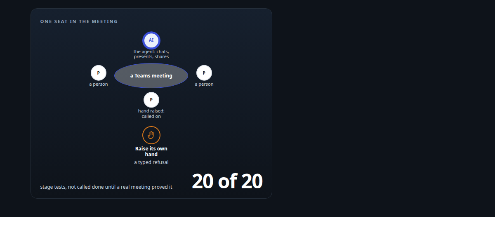
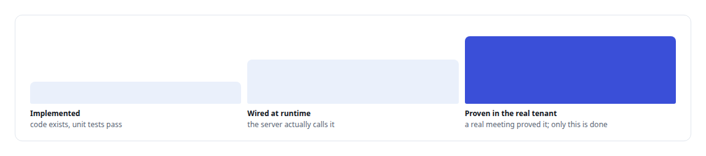
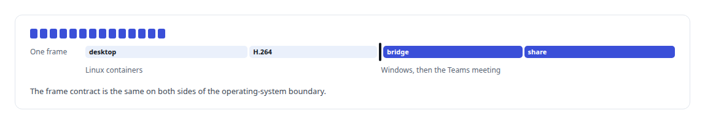
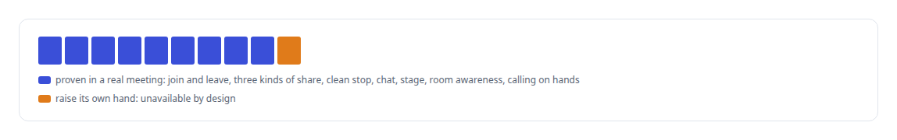

# A meeting attendee that will not fake it

**An AI participant that chats, presents slides and shares a screen in Teams, and says plainly what the platform will not let it do**

Canonical: https://coreyjames.ai/stories/a-meeting-attendee-that-will-not-fake-it/  
Author: Corey James · Published: 2026-10-28 · Kind: story  
DOI: https://doi.org/10.5281/zenodo.23735146 (this page is a chapter of the system's report)  
Systems: [Helix](https://github.com/coreyjames-ai/helix)  
Technologies: [Bash](https://github.com/coreyjames-ai/portfolio/tree/main/technologies/bash) · [C#](https://github.com/coreyjames-ai/portfolio/tree/main/technologies/c-sharp) · [Evidence-gated acceptance](https://github.com/coreyjames-ai/portfolio/tree/main/technologies/evidence-gated-acceptance) · [FFmpeg](https://github.com/coreyjames-ai/portfolio/tree/main/technologies/ffmpeg) · [H.264](https://github.com/coreyjames-ai/portfolio/tree/main/technologies/h-264) · [JavaScript](https://github.com/coreyjames-ai/portfolio/tree/main/technologies/javascript) · [MCP tool design](https://github.com/coreyjames-ai/portfolio/tree/main/technologies/mcp-tool-design) · [Microsoft Agent 365](https://github.com/coreyjames-ai/portfolio/tree/main/technologies/microsoft-agent-365) · [Microsoft Graph](https://github.com/coreyjames-ai/portfolio/tree/main/technologies/microsoft-graph) · [Microsoft Teams](https://github.com/coreyjames-ai/portfolio/tree/main/technologies/microsoft-teams) · [Model Context Protocol (MCP)](https://github.com/coreyjames-ai/portfolio/tree/main/technologies/model-context-protocol-mcp) · [React](https://github.com/coreyjames-ai/portfolio/tree/main/technologies/react) · [Rust](https://github.com/coreyjames-ai/portfolio/tree/main/technologies/rust) · [Speech recognition model](https://github.com/coreyjames-ai/portfolio/tree/main/technologies/speech-recognition-model)  
Skills: [evidence-gated acceptance](https://github.com/coreyjames-ai/portfolio/tree/main/skills/evidence-gated-acceptance) · [tool synthesis and governed API integration](https://github.com/coreyjames-ai/portfolio/tree/main/skills/tool-synthesis-and-governed-api-integration) · [distributed systems correctness](https://github.com/coreyjames-ai/portfolio/tree/main/skills/distributed-systems-correctness) · [AI-assisted engineering methodology](https://github.com/coreyjames-ai/portfolio/tree/main/skills/ai-assisted-engineering-methodology)  



## Result

| Figure | What it measures |
| --- | --- |
| **13** | meeting actions, each with an exact schema |
| **1** | action that refuses by design: raising its own hand |
| **55 of 55** | unit tests passing before a real meeting had proved the tools |

## What was built

I wanted the digital employee to be a useful participant in a Teams meeting: follow the chat, put slides on the stage and drive them, notice who has a hand up and call on them, share a terminal or a browser so people can watch it work. It does all of that. It does not raise its own hand, because Microsoft's platform offers no supported way for it to, and I built that as an honest refusal instead of reporting a hand raised from local state.

## The challenge

Meeting participation is many small capabilities, each with its own platform seam, and some of those seams do not exist. Native PowerPoint Live exposes no control or event hooks. The hand-raise state is visible to a bot and not writable. The agent's pixels originate in a Linux container while publication to Teams goes through a Windows media bot. And AI-assisted engineering teams are very good at producing plausible claims that something works, which is the wrong property when tests in the real tenant are scarce.

## Constraints

No supported path means no feature. Video had to cross two operating systems and a vendor platform with a single typed frame contract. And every test against the real tenant had to count.

## My approach

A strict evidence vocabulary: implemented is not wired at runtime is not proven in a real meeting. Each action moved through those states with its own evidence, and nothing was called done until a real meeting had proved it, however many unit tests passed. Where the platform had no supported path, the action failed closed with a named reason.



## What I built

Meeting actions with exact per-action schemas, served from a Rust MCP server bound to the employee identity.

A room-state projector that gives the agent a current picture of who is present and who has a hand up, and a chat adapter bound to the employee so its messages are its own.

A Teams meeting-stage app plus an authenticated relay, so the agent drives a deck on the stage itself. This replaced the PowerPoint Live route, which had no seam to drive.

A hand coordinator that returns a typed "hand mutation unavailable", because the platform does not support it.

A headless desktop as a video source: a virtual display, window manager, browser and terminal, captured by FFmpeg and framed as H.264 to the media bridge, published into the meeting as screen share. Terminal content is typed at a human-readable speed so watchers can follow it.



Acceptance scripts that clean up after themselves even on failure.

## Difficult decisions

Honest refusals over local state. The agent could have tracked a "raised" flag locally and reported it. Nobody in the meeting would have seen a hand.

Pivoting presentation. PowerPoint Live was the obvious target and had no control surface. Moving to an installed meeting-stage app cost a rewrite and gave the agent a deck it can drive.

Not done at 55 of 55. The second-generation tools passed every unit test and every stage test. I did not call them done until each one had worked in a real meeting.


## Results



## Technologies used

Rust MCP server · Microsoft Graph · TeamsJS meeting-stage app · Node.js relay · Xvfb, Openbox and Chromium · FFmpeg H.264 framing · C# screen-share publication · Shell acceptance harnesses

## What this demonstrates

I build systems that report their limits as accurately as their capabilities, and I can carry video end to end across Linux, Windows and a vendor meeting platform with one typed contract.

I set the evidence vocabulary and the fail-closed rule and made the presentation pivot; AI coding agents, a mix of frontier and open-source models, implemented the actions and harnesses under my direction. The meeting platform is Microsoft's.

> Tests that pass are not a meeting that worked.

## What was verified

Each line is a claim the canonical page supports, with the figure as the page states it.

- MCP server design: 13 meeting actions for an AI participant in Teams, each with an exact schema, acting as one named employee.
- Evidence-gated acceptance: an action counts as done only once proven in a real meeting, not when its 55 of 55 unit tests pass.
- Screen sharing from Linux agents into Teams: a headless desktop captured as H.264 frames and published into the meeting through a Windows media bridge.
- Honest failure design for AI agents: the one action the platform does not support, raising its own hand, returns a named refusal instead of a fake.

## Related

- [A self-hosted colleague in a Teams call](https://github.com/coreyjames-ai/helix/tree/main/stories/a-self-hosted-colleague-in-a-teams-call) · https://coreyjames.ai/stories/a-self-hosted-colleague-in-a-teams-call/
- [Solving the digital-employee identity](https://github.com/coreyjames-ai/helix/tree/main/stories/solving-the-digital-employee-identity) · https://coreyjames.ai/stories/solving-the-digital-employee-identity/

## Citation

Corey James. "A meeting attendee that will not fake it." coreyjames.ai, 2026. https://coreyjames.ai/stories/a-meeting-attendee-that-will-not-fake-it/ In: the Helix technical report, doi:10.5281/zenodo.23735146.

```bibtex
@misc{coreyjames-a-meeting-attendee-that-will-not-fake-it,
  author = {Corey James},
  title = {A meeting attendee that will not fake it},
  year = {2026},
  howpublished = {\url{https://coreyjames.ai/stories/a-meeting-attendee-that-will-not-fake-it/}},
  note = {GitHub copy: https://github.com/coreyjames-ai/helix/tree/main/stories/a-meeting-attendee-that-will-not-fake-it},
  doi = {10.5281/zenodo.23735146}
}
```

Part of [Helix](https://github.com/coreyjames-ai/helix) and [Corey James's portfolio](https://github.com/coreyjames-ai/portfolio) · site: https://coreyjames.ai/ · MCP server: https://coreyjames.ai/mcp · agent card: https://coreyjames.ai/.well-known/agent.json
