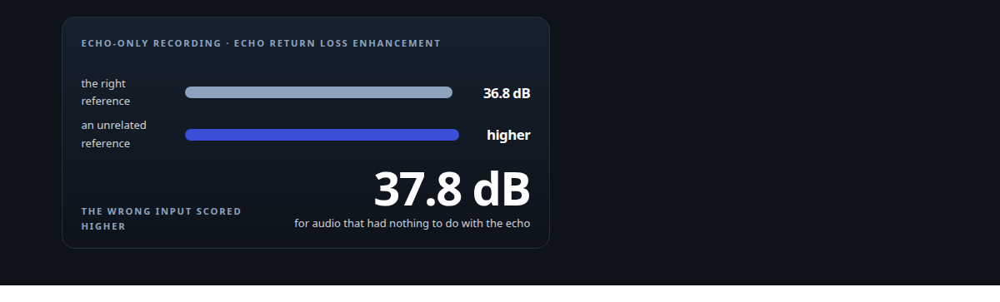
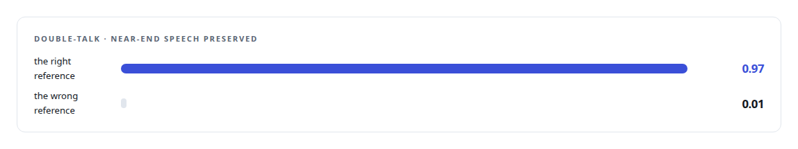
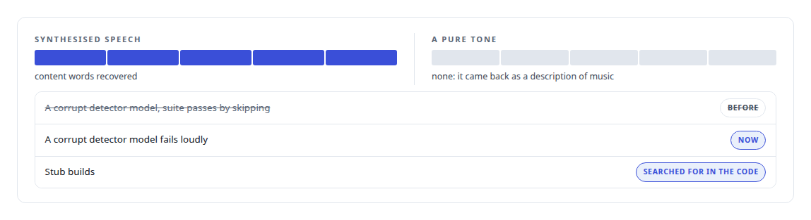

# A proof that proved nothing

**An echo-cancellation score looked excellent until an unrelated reference scored higher; the rebuilt proof uses a negative control, and the same discipline runs through the voice engine's tests**

Canonical: https://coreyjames.ai/stories/a-proof-that-proved-nothing/  
Author: Corey James · Published: 2026-10-28 · Kind: story  
Systems: [Helix](https://github.com/coreyjames-ai/helix)  
Technologies: [Determinism and numerical reproducibility](https://github.com/coreyjames-ai/portfolio/tree/main/technologies/determinism-and-numerical-reproducibility) · [ML evaluation methodology](https://github.com/coreyjames-ai/portfolio/tree/main/technologies/ml-evaluation-methodology) · [Real-time audio pipeline engineering](https://github.com/coreyjames-ai/portfolio/tree/main/technologies/real-time-audio-pipeline-engineering) · [Rust](https://github.com/coreyjames-ai/portfolio/tree/main/technologies/rust)  
Skills: [speech recognition and synthesis pipelines](https://github.com/coreyjames-ai/portfolio/tree/main/skills/speech-recognition-and-synthesis-pipelines) · [AI-assisted engineering methodology](https://github.com/coreyjames-ai/portfolio/tree/main/skills/ai-assisted-engineering-methodology)  



## Result

| Figure | What it measures |
| --- | --- |
| **5 of 5** | content words recovered from synthesised speech |
| **0** | for a pure tone, which came back as a description of music |
| **2** | layers of echo cancellation, the engine and the desk device |

## What was built

The voice engine cancels its own echo with the WebRTC AEC3 algorithm, fed the engine's own playback as the reference, in ten-millisecond blocks, with the delay seeded from the device clocks. The first proof that it worked reported an echo return loss enhancement of 36.8 decibels on an echo-only recording, which is an excellent number. Then the same test was run with an uncorrelated reference, audio that had nothing to do with the echo, and it scored 37.8.

## What the number was measuring

The canceller has a suppressor stage that gates low-level signal, and on an echo-only recording the suppressor was doing all the work: whatever the reference, it attenuated the echo because the echo was all there was. The score was real and it discriminated nothing.


## The rebuilt proof

The replacement test is double-talk, a person speaking over the agent's playback, which is the case echo cancellation exists for.



The negative control is the proof: the number moves when the input is right and collapses when it is wrong, so it measures the canceller and not the suppressor. The canceller's binding to its volatile native library is isolated in one file behind a trait.

## The same discipline elsewhere



A mishearing in one run was kept as stronger evidence of a real pipeline than a perfect match would have been.

## What this demonstrates

I test audio by asking whether a passing number could pass for the wrong reason, and by building the control that would catch it. The ERLE figure was thrown out, and the engine's acceptance tests are the ones that fail when they should.

The decision to discard the first proof was mine; AI coding agents, a mix of frontier and open-source models, rebuilt the tests under my governance system.

> A proof that passes with the wrong input is a proof of the test harness.

## What was verified

Each line is a claim the canonical page supports, with the figure as the page states it.

- ML evaluation methodology: an echo-cancellation score of 36.8 thrown out after an unrelated reference scored 37.8; the proof was rebuilt around a negative control.
- Echo cancellation engineering: AEC3 fed the engine's own playback as its reference in ten-millisecond blocks, tested under double-talk.
- Speech pipeline testing: synthesised speech recovering 5 of 5 content words, with a pure tone coming back as 0.

## Related

- [Interruptions that only people can make](https://github.com/coreyjames-ai/helix/tree/main/stories/interruptions-that-only-people-can-make) · https://coreyjames.ai/stories/interruptions-that-only-people-can-make/
- [Fast transcripts that were wrong](https://github.com/coreyjames-ai/helix/tree/main/stories/fast-transcripts-that-were-wrong) · https://coreyjames.ai/stories/fast-transcripts-that-were-wrong/
- [Tests that passed without a GPU](https://github.com/coreyjames-ai/inference-fabric/tree/main/stories/tests-that-passed-without-a-gpu) · https://coreyjames.ai/stories/tests-that-passed-without-a-gpu/

## Citation

Corey James. "A proof that proved nothing." coreyjames.ai, 2026. https://coreyjames.ai/stories/a-proof-that-proved-nothing/

```bibtex
@misc{coreyjames-a-proof-that-proved-nothing,
  author = {Corey James},
  title = {A proof that proved nothing},
  year = {2026},
  howpublished = {\url{https://coreyjames.ai/stories/a-proof-that-proved-nothing/}},
  note = {GitHub copy: https://github.com/coreyjames-ai/helix/tree/main/stories/a-proof-that-proved-nothing}
}
```

Part of [Helix](https://github.com/coreyjames-ai/helix) and [Corey James's portfolio](https://github.com/coreyjames-ai/portfolio) · site: https://coreyjames.ai/ · MCP server: https://coreyjames.ai/mcp · agent card: https://coreyjames.ai/.well-known/agent.json
