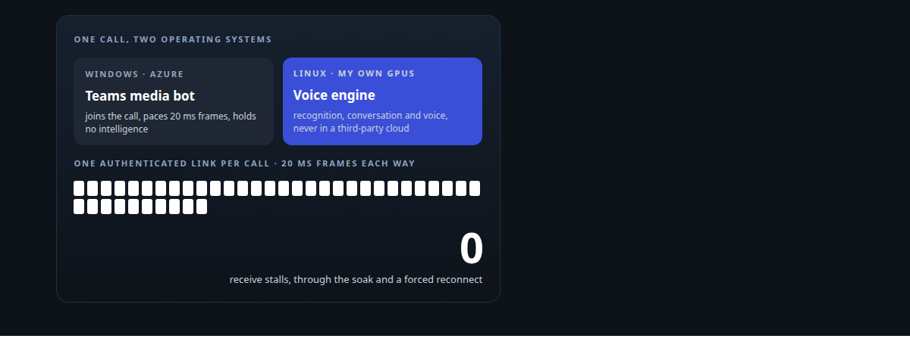
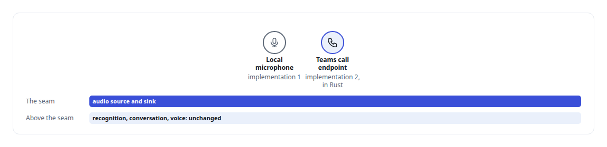
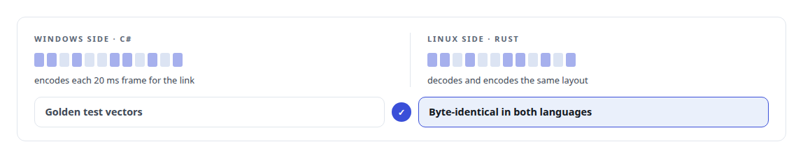
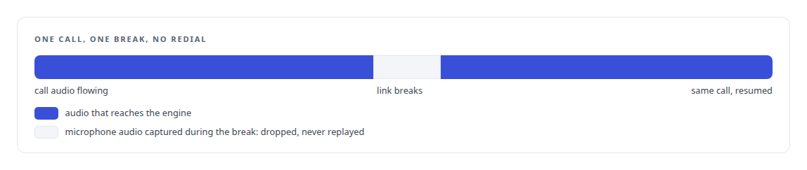
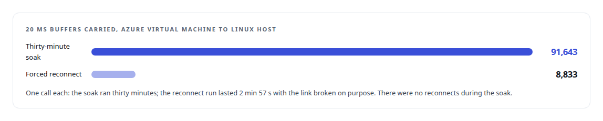

# A self-hosted colleague in a Teams call

**Bridging Microsoft's real-time media stack to a voice AI that never leaves my own hardware**

Canonical: https://coreyjames.ai/stories/a-self-hosted-colleague-in-a-teams-call/  
Author: Corey James · Published: 2026-10-28 · Kind: story  
DOI: https://doi.org/10.5281/zenodo.23735146 (this page is a chapter of the system's report)  
Systems: [Helix](https://github.com/coreyjames-ai/helix)  
Technologies: [Axum](https://github.com/coreyjames-ai/portfolio/tree/main/technologies/axum) · [Binary wire protocol design](https://github.com/coreyjames-ai/portfolio/tree/main/technologies/binary-wire-protocol-design) · [C#](https://github.com/coreyjames-ai/portfolio/tree/main/technologies/c-sharp) · [Conversational turn-taking and barge-in](https://github.com/coreyjames-ai/portfolio/tree/main/technologies/conversational-turn-taking-and-barge-in) · [H.264](https://github.com/coreyjames-ai/portfolio/tree/main/technologies/h-264) · [Mattermost](https://github.com/coreyjames-ai/portfolio/tree/main/technologies/mattermost) · [Microsoft Azure](https://github.com/coreyjames-ai/portfolio/tree/main/technologies/microsoft-azure) · [Microsoft Graph](https://github.com/coreyjames-ai/portfolio/tree/main/technologies/microsoft-graph) · [Microsoft Teams](https://github.com/coreyjames-ai/portfolio/tree/main/technologies/microsoft-teams) · [Microsoft real-time media SDK](https://github.com/coreyjames-ai/portfolio/tree/main/technologies/microsoft-real-time-media-sdk) · [NVIDIA Blackwell GPUs](https://github.com/coreyjames-ai/portfolio/tree/main/technologies/nvidia-blackwell-gpus) · [ONNX Runtime](https://github.com/coreyjames-ai/portfolio/tree/main/technologies/onnx-runtime) · [Real-time audio pipeline engineering](https://github.com/coreyjames-ai/portfolio/tree/main/technologies/real-time-audio-pipeline-engineering) · [Rust](https://github.com/coreyjames-ai/portfolio/tree/main/technologies/rust) · [Speech recognition model](https://github.com/coreyjames-ai/portfolio/tree/main/technologies/speech-recognition-model) · [Speech synthesis model](https://github.com/coreyjames-ai/portfolio/tree/main/technologies/speech-synthesis-model) · [Tokio](https://github.com/coreyjames-ai/portfolio/tree/main/technologies/tokio) · [Vendor-integration reverse engineering](https://github.com/coreyjames-ai/portfolio/tree/main/technologies/vendor-integration-reverse-engineering) · [WebSocket](https://github.com/coreyjames-ai/portfolio/tree/main/technologies/websocket)  
Skills: [Microsoft Teams real-time media](https://github.com/coreyjames-ai/portfolio/tree/main/skills/microsoft-teams-real-time-media) · [real-time voice AI](https://github.com/coreyjames-ai/portfolio/tree/main/skills/real-time-voice-ai) · [distributed systems correctness](https://github.com/coreyjames-ai/portfolio/tree/main/skills/distributed-systems-correctness) · [Rust systems engineering](https://github.com/coreyjames-ai/portfolio/tree/main/skills/rust-systems-engineering)  



## Result

| Figure | What it measures |
| --- | --- |
| **50.001/s** | buffers per second across the soak, against 20 ms pacing |
| **250 ms** | the single retry in a forced mid-call reconnect |
| **67 ms** | round-trip media latency at most in a single probe, 65 at least |

## What was built

I rang a Microsoft Teams number, a digital employee answered, and we had a two-way spoken conversation. The speech recognition, the conversation engine and the voice all ran on GPUs in my own rack. Nothing about the call touched a third-party AI cloud. Making that possible meant building a bridge between two worlds that were never designed to meet: Microsoft's Windows-only real-time media stack and a Linux voice engine, joined by a purpose-built audio link that survived a thirty-minute soak and a forced mid-call reconnect before I would call it done.

## The challenge

Microsoft Teams will hand raw call audio to a bot, and only to a Windows application built on Microsoft's real-time media SDK. My voice engine, with its speech models and conversation logic, runs on Linux GPUs, and I was not going to send call audio to someone else's AI service to avoid the mismatch. The bot had to sit on Windows in Azure, the brain had to stay on my hardware, and the two had to exchange audio in real time across clouds without the conversation noticing.

## Constraints

A preview SDK with strict rules: unmanaged audio buffers with exact lifetimes and 20-millisecond pacing. Miss the pacing and the call stutters; mishandle a buffer and the process dies. Cross-cloud latency within the budget a conversation tolerates. No intelligence in the bridge, so it could be replaced without touching the AI. And a real identity: the bot joins calls as a governed digital employee in the Microsoft tenant.

## My approach

I treated Teams as one more microphone and speaker. The engine already had a sealed audio seam, an abstract source and sink that its local voice interface used. Teams became another implementation of that seam. That reduced the problem to three parts: a Windows service that speaks the SDK's language and nothing else, an audio link with exactly the properties a conversation needs, and a Rust endpoint on my side that presents the link to the engine as a source and sink it already understood.



## What I built

A .NET 8 Windows service on Microsoft's media SDK that joins calls, receives and sends 20-millisecond audio frames, and does nothing else.

A binary audio and video wire protocol over one authenticated WebSocket per call, implemented twice, in C# and in Rust, with the two implementations proven byte-identical against golden test vectors before either was trusted.



A Rust endpoint that implements the engine's audio source and sink, so the engine cannot tell a Teams call from a local microphone.

Same-call reconnect: if the link breaks mid-call, the bridge reconnects within the same call and resumes without anyone redialling.

Deployment on an Azure virtual machine with managed identity and vault-held secrets, reachable only through an authenticated access layer.

## Difficult decisions

Keeping the brain at home. The cheaper design was to let the Windows bot talk to a hosted speech service directly. That would have removed the bridge and put every call's audio in a third party's hands. I took the cross-OS bridge as the price of ownership.

Dropping audio on reconnect. When the link recovers, there is a choice between replaying the microphone audio captured during the break and discarding it. I drop it, and the person repeats themselves if they need to.




Trusting Teams for voice isolation. The local engine has its own filter for keeping one speaker in focus. In a Teams call the platform already isolates voices well, so I rely on that, and I wrote down the reasoning that would reverse it.

## Results



The first call's spoken replies arrived several seconds late because speech synthesis was sharing a GPU with everything else; speech later moved to a dedicated host. Interruption handling on the Teams side, where a participant talks over the agent and it stops, came after that baseline.

## Technologies used

C# and .NET 8 · Microsoft Graph Communications real-time media SDK · Azure virtual machines, Key Vault and managed identity · Rust with Tokio and Axum · Custom binary wire protocols over WebSocket · Real-time audio framing and pacing · Speech recognition · Neural speech synthesis

## What this demonstrates

I integrate deeply with a vendor's real-time platform while keeping the parts that matter on hardware I control. I test failure before I test success: the soak and the forced reconnect were acceptance criteria, and the trade-offs are written down so the next engineer knows why the audio is dropped and when that should change.

I designed the bridge and the audio seam, set the acceptance tests, and directed AI coding agents, a mix of frontier and open-source models, under my governance system. Microsoft's media SDK and Teams are third-party; the bridge, the protocol and the engine integration are mine.

> Replaying produces a colleague who answers a question from twenty seconds ago.

## What was verified

Each line is a claim the canonical page supports, with the figure as the page states it.

- Microsoft Teams real-time media: a self-hosted AI colleague in Teams calls through a Windows media bridge on Azure, carrying 20 ms buffers at 50.001 per second with no receive stalls.
- Binary wire protocol design: one authenticated full-duplex audio link per call, implemented in C# and in Rust and proven byte-identical against golden test vectors.
- Distributed systems correctness: a forced mid-call reconnect resumed the same call after a single 250 ms retry, dropping audio from the gap instead of replaying it.
- Real-time voice AI on local GPUs: recognition, conversation and voice kept on my own hardware behind the engine's existing audio seam, with 65 to 67 ms round-trip media latency.

## Related

- [Solving the digital-employee identity](https://github.com/coreyjames-ai/helix/tree/main/stories/solving-the-digital-employee-identity) · https://coreyjames.ai/stories/solving-the-digital-employee-identity/
- [A meeting attendee that will not fake it](https://github.com/coreyjames-ai/helix/tree/main/stories/a-meeting-attendee-that-will-not-fake-it) · https://coreyjames.ai/stories/a-meeting-attendee-that-will-not-fake-it/

## Citation

Corey James. "A self-hosted colleague in a Teams call." coreyjames.ai, 2026. https://coreyjames.ai/stories/a-self-hosted-colleague-in-a-teams-call/ In: the Helix technical report, doi:10.5281/zenodo.23735146.

```bibtex
@misc{coreyjames-a-self-hosted-colleague-in-a-teams-call,
  author = {Corey James},
  title = {A self-hosted colleague in a Teams call},
  year = {2026},
  howpublished = {\url{https://coreyjames.ai/stories/a-self-hosted-colleague-in-a-teams-call/}},
  note = {GitHub copy: https://github.com/coreyjames-ai/helix/tree/main/stories/a-self-hosted-colleague-in-a-teams-call},
  doi = {10.5281/zenodo.23735146}
}
```

Part of [Helix](https://github.com/coreyjames-ai/helix) and [Corey James's portfolio](https://github.com/coreyjames-ai/portfolio) · site: https://coreyjames.ai/ · MCP server: https://coreyjames.ai/mcp · agent card: https://coreyjames.ai/.well-known/agent.json
