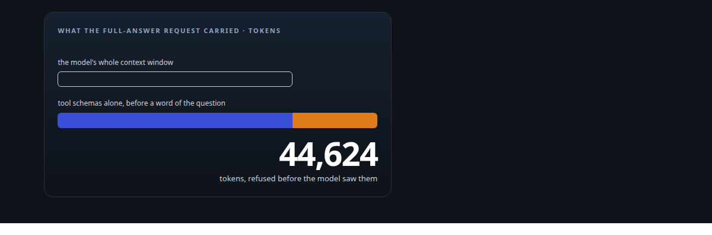
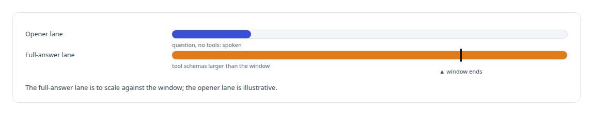
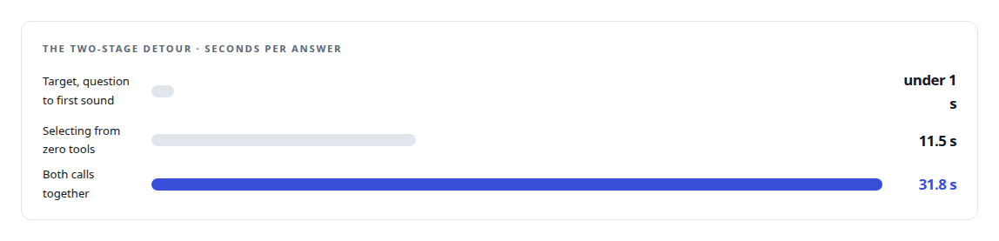
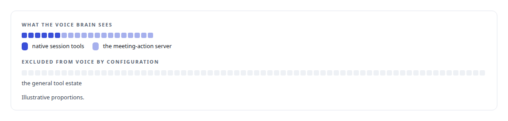

# A tool catalogue bigger than the model

**Why a voice assistant played its opener and then fell silent, the two-stage fix I rolled back, and the boundary that replaced it**

Canonical: https://coreyjames.ai/stories/a-tool-catalogue-bigger-than-the-model/  
Author: Corey James · Published: 2026-10-28 · Kind: story  
DOI: https://doi.org/10.5281/zenodo.23735146 (this page is a chapter of the system's report)  
Systems: [Helix](https://github.com/coreyjames-ai/helix) · [FAFOHive](https://github.com/coreyjames-ai/fafohive)  
Technologies: [Context engineering and persistent agent memory](https://github.com/coreyjames-ai/portfolio/tree/main/technologies/context-engineering-and-persistent-agent-memory) · [MCP tool design](https://github.com/coreyjames-ai/portfolio/tree/main/technologies/mcp-tool-design) · [Model Context Protocol (MCP)](https://github.com/coreyjames-ai/portfolio/tree/main/technologies/model-context-protocol-mcp) · [Rust](https://github.com/coreyjames-ai/portfolio/tree/main/technologies/rust)  
Skills: [AI-assisted engineering methodology](https://github.com/coreyjames-ai/portfolio/tree/main/skills/ai-assisted-engineering-methodology) · [tool synthesis and governed API integration](https://github.com/coreyjames-ai/portfolio/tree/main/skills/tool-synthesis-and-governed-api-integration) · [distributed systems correctness](https://github.com/coreyjames-ai/portfolio/tree/main/skills/distributed-systems-correctness) · [inference serving architecture](https://github.com/coreyjames-ai/portfolio/tree/main/skills/inference-serving-architecture)  



## Result

| Figure | What it measures |
| --- | --- |
| **88** | remote tools offered to the voice brain |
| **300** | provider operations kept out of voice by configuration |

## What was built

The voice engine reaches the world through tools: native ones for assigning work, saving and searching memory, and setting the voiceprint policy, and remote ones over the tool protocol, including the meeting-action server that lets it join a Teams meeting, raise a hand or put a deck on screen. One day the assistant began speaking its short opener and then falling silent where the full answer should have been.

## The arithmetic

The tool list alone was larger than the model's entire 32,768-token window, so every full request was refused by the serving layer, while the tool-free opener sailed through and made the failure look like a stall.



## The detour

The first fix was a two-stage design: ask the model to pick which tools it needed, then make the real request with only those.




The design was rolled back to the previous backend the same day.

## The fix

Tools are scoped to the surface, because a spoken assistant does not need every provider operation in its working memory to answer a question in a meeting.



The engine also repairs tool arguments the model gets slightly wrong, renaming known-wrong keys and logging the rename, because a small model will write a variable name where a value belongs. Identity for delegated work comes from the credential the engine holds, never from a spoken tenant or id, and receipts are idempotent so a spoken retry after a lost reply does not run the work twice.

The permanent answer to the same problem, for every agent rather than one voice, is the tool-discovery model in [A hundred tokens instead of forty-two thousand](https://coreyjames.ai/stories/a-hundred-tokens-instead-of-forty-two-thousand), which compiles the catalogue into a small model so no agent carries the schemas at all.

## What this demonstrates

I diagnosed the failure from the one lane that worked, rejected a plausible fix on its measured cost, and drew the boundary where it belongs: each surface gets the tools its job needs.

The rollback and the scoping decision were mine; AI coding agents, a mix of frontier and open-source models, implemented and measured both under my governance system.

> It worked and it was unusable.

## What was verified

Each line is a claim the canonical page supports, with the figure as the page states it.

- MCP tool design: diagnosed a voice assistant that fell silent because its tool list was larger than the model's 32,768-token window.
- Context budgeting for small models: tools scoped to each surface, keeping 300 provider operations out of voice while 88 remote tools stay available.
- Robust tool calling: tool arguments repaired when a small model misnames keys, with idempotent receipts so a spoken retry never runs work twice.

## Related

- [A hundred tokens instead of forty-two thousand](https://github.com/coreyjames-ai/capabilities-model/tree/main/stories/a-hundred-tokens-instead-of-forty-two-thousand) · https://coreyjames.ai/stories/a-hundred-tokens-instead-of-forty-two-thousand/
- [From two seconds to under one](https://github.com/coreyjames-ai/helix/tree/main/stories/from-two-seconds-to-under-one) · https://coreyjames.ai/stories/from-two-seconds-to-under-one/
- [The same brain, typed or spoken](https://github.com/coreyjames-ai/helix/tree/main/stories/the-same-brain-typed-or-spoken) · https://coreyjames.ai/stories/the-same-brain-typed-or-spoken/

## Citation

Corey James. "A tool catalogue bigger than the model." coreyjames.ai, 2026. https://coreyjames.ai/stories/a-tool-catalogue-bigger-than-the-model/ In: the Helix technical report, doi:10.5281/zenodo.23735146.

```bibtex
@misc{coreyjames-a-tool-catalogue-bigger-than-the-model,
  author = {Corey James},
  title = {A tool catalogue bigger than the model},
  year = {2026},
  howpublished = {\url{https://coreyjames.ai/stories/a-tool-catalogue-bigger-than-the-model/}},
  note = {GitHub copy: https://github.com/coreyjames-ai/helix/tree/main/stories/a-tool-catalogue-bigger-than-the-model},
  doi = {10.5281/zenodo.23735146}
}
```

Part of [Helix](https://github.com/coreyjames-ai/helix) and [Corey James's portfolio](https://github.com/coreyjames-ai/portfolio) · site: https://coreyjames.ai/ · MCP server: https://coreyjames.ai/mcp · agent card: https://coreyjames.ai/.well-known/agent.json
