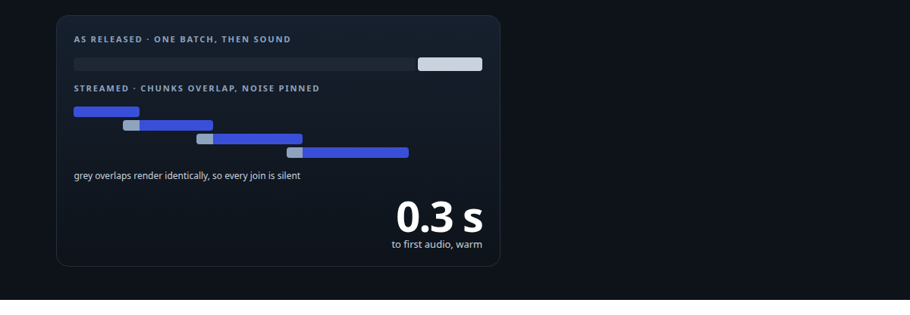
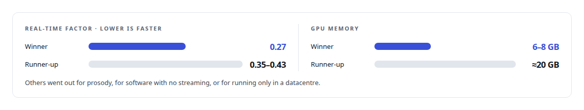
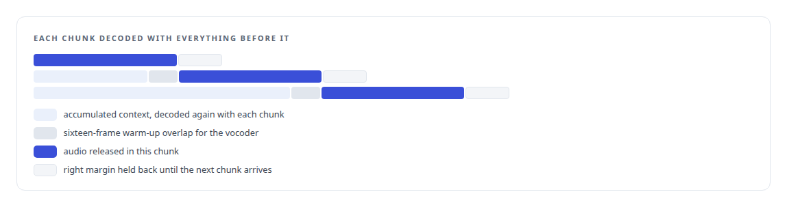
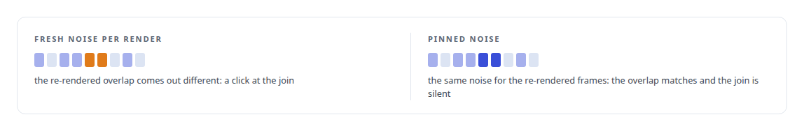

# Building the streaming my speech model did not ship

**The open-weight voice model I chose had no streaming hook, so I ported its token loop, decoded its audio in chunks and pinned its diffusion noise so the joins are seamless**

Canonical: https://coreyjames.ai/stories/building-the-streaming-my-speech-model-did-not-ship/  
Author: Corey James · Published: 2026-10-28 · Kind: story  
Systems: [Helix](https://github.com/coreyjames-ai/helix)  
Technologies: [NVIDIA Blackwell GPUs](https://github.com/coreyjames-ai/portfolio/tree/main/technologies/nvidia-blackwell-gpus) · [PyTorch](https://github.com/coreyjames-ai/portfolio/tree/main/technologies/pytorch) · [Python](https://github.com/coreyjames-ai/portfolio/tree/main/technologies/python) · [Real-time audio pipeline engineering](https://github.com/coreyjames-ai/portfolio/tree/main/technologies/real-time-audio-pipeline-engineering)  
Skills: [AI-assisted engineering methodology](https://github.com/coreyjames-ai/portfolio/tree/main/skills/ai-assisted-engineering-methodology) · [speech recognition and synthesis pipelines](https://github.com/coreyjames-ai/portfolio/tree/main/skills/speech-recognition-and-synthesis-pipelines)  



## Result

| Figure | What it measures |
| --- | --- |
| **8** | synthesisers in the bake-off |
| **12** | tokens before the first chunk is released |
| **56** | voices registered, each persona with its own |

## What was built

The voice model was chosen in a bake-off on the criteria that matter in a conversation: time to first audio, real-time factor, memory, licence, voice cloning and streaming. The winner carried a permissive licence.



 One law came out of the bake-off and stands over every voice on the site: never clone a real human voice without documented consent.

The winner had one problem. Its released package produced audio in a batch: about 1.6 seconds to the first sound regardless of how short the sentence was. That is a fixed tax on every reply, and the package exposed no way to stream.

## Porting the loop

The model generates speech tokens with a transformer and turns them into audio with a diffusion decoder and a vocoder. The released code ran the token loop to completion and decoded once. The streaming server ports the token loop so tokens are consumed as they are produced. The decoder's encoder is bidirectional, so each chunk is decoded with the full accumulated context rather than in isolation. The vocoder is kept continuous across chunks with a left warm-up overlap and a right margin held back until the next chunk arrives.



## Pinning the noise

A diffusion decoder starts from random noise, and re-rendering a region with fresh noise produces audio that is different enough to click at the join. The server pins the noise: the same noise is reused for the re-rendered frames, so the overlap renders identically and the joins are seamless.




## The rest of the path

First audio dropped to between 150 and 350 milliseconds warm, measured at the client as a first frame of 306 to 318 milliseconds. The client reads chunked audio per clause over a socket with the delay algorithm turned off, after a reader rewrite removed a 1.5-second regression, and a permit semaphore lets two clauses be synthesised ahead of playback. The server cancels cooperatively when a person interrupts, with checkpoints inside each request and a lock that cannot be won after cancellation, so an interrupted sentence stops in the synthesiser and not only at the speaker. The server preloads its compiled kernels for the Blackwell architecture.

Speech synthesis then moved to a dedicated GPU host, after a measurement showed that sharing a card with an embedding service was the cause of slow Teams turns, in [One percent network, seventy-eight percent GPU](https://coreyjames.ai/stories/one-percent-network-seventy-eight-percent-gpu).

## What this demonstrates

I can take an open-weight model past what its authors released, by reading the architecture rather than the API: the token loop, the decoder's context and the sampler's noise each had to be understood before streaming could be made both fast and clean.

The choice of model, the consent law and the decision to build streaming were mine; AI coding agents, a mix of frontier and open-source models, implemented the server under my governance system.

> A small patch over the sampler is the difference between streaming that works and streaming that crackles.

## What was verified

Each line is a claim the canonical page supports, with the figure as the page states it.

- Speech synthesis engineering: streaming built for an open-weight voice model that had none, cutting time to first audio to about 0.3 s from about 1.6.
- Model evaluation and selection: 8 synthesisers compared on time to first audio, real-time factor, memory, licence, voice cloning and streaming.
- Diffusion sampling control: noise pinned across chunk overlaps so every join renders identically and streams without clicks, first chunk after 12 tokens.
- Responsible voice AI: 56 registered voices under a rule never to clone a real human voice without documented consent.

## Related

- [From two seconds to under one](https://github.com/coreyjames-ai/helix/tree/main/stories/from-two-seconds-to-under-one) · https://coreyjames.ai/stories/from-two-seconds-to-under-one/
- [Three hundred milliseconds of hello](https://github.com/coreyjames-ai/helix/tree/main/stories/three-hundred-milliseconds-of-hello) · https://coreyjames.ai/stories/three-hundred-milliseconds-of-hello/
- [A self-hosted colleague in a Teams call](https://github.com/coreyjames-ai/helix/tree/main/stories/a-self-hosted-colleague-in-a-teams-call) · https://coreyjames.ai/stories/a-self-hosted-colleague-in-a-teams-call/
- [One percent network, seventy-eight percent GPU](https://github.com/coreyjames-ai/helix/tree/main/stories/one-percent-network-seventy-eight-percent-gpu) · https://coreyjames.ai/stories/one-percent-network-seventy-eight-percent-gpu/

## Citation

Corey James. "Building the streaming my speech model did not ship." coreyjames.ai, 2026. https://coreyjames.ai/stories/building-the-streaming-my-speech-model-did-not-ship/

```bibtex
@misc{coreyjames-building-the-streaming-my-speech-model-did-not-ship,
  author = {Corey James},
  title = {Building the streaming my speech model did not ship},
  year = {2026},
  howpublished = {\url{https://coreyjames.ai/stories/building-the-streaming-my-speech-model-did-not-ship/}},
  note = {GitHub copy: https://github.com/coreyjames-ai/helix/tree/main/stories/building-the-streaming-my-speech-model-did-not-ship}
}
```

Part of [Helix](https://github.com/coreyjames-ai/helix) and [Corey James's portfolio](https://github.com/coreyjames-ai/portfolio) · site: https://coreyjames.ai/ · MCP server: https://coreyjames.ai/mcp · agent card: https://coreyjames.ai/.well-known/agent.json
