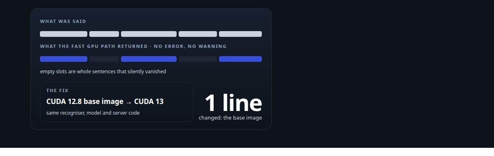
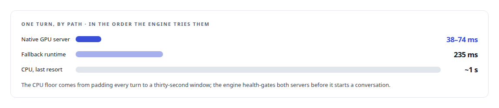
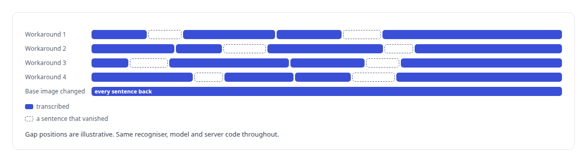
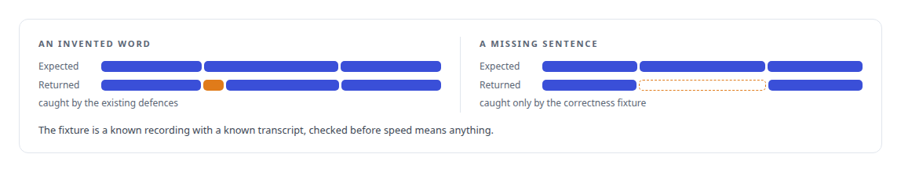

# Fast transcripts that were wrong

**GPU speech recognition that was far faster than the CPU path and quietly dropped sentences, and the correctness gate every GPU integration in the voice engine now passes**

Canonical: https://coreyjames.ai/stories/fast-transcripts-that-were-wrong/  
Author: Corey James · Published: 2026-10-28 · Kind: story  
DOI: https://doi.org/10.5281/zenodo.23735146 (this page is a chapter of the system's report)  
Systems: [Helix](https://github.com/coreyjames-ai/helix)  
Technologies: [Docker](https://github.com/coreyjames-ai/portfolio/tree/main/technologies/docker) · [ML evaluation methodology](https://github.com/coreyjames-ai/portfolio/tree/main/technologies/ml-evaluation-methodology) · [NVIDIA Blackwell GPUs](https://github.com/coreyjames-ai/portfolio/tree/main/technologies/nvidia-blackwell-gpus) · [Real-time audio pipeline engineering](https://github.com/coreyjames-ai/portfolio/tree/main/technologies/real-time-audio-pipeline-engineering) · [Speech recognition model](https://github.com/coreyjames-ai/portfolio/tree/main/technologies/speech-recognition-model)  
Skills: [GPU inference optimisation](https://github.com/coreyjames-ai/portfolio/tree/main/skills/gpu-inference-optimisation) · [AI-assisted engineering methodology](https://github.com/coreyjames-ai/portfolio/tree/main/skills/ai-assisted-engineering-methodology) · [distributed systems correctness](https://github.com/coreyjames-ai/portfolio/tree/main/skills/distributed-systems-correctness) · [inference serving architecture](https://github.com/coreyjames-ai/portfolio/tree/main/skills/inference-serving-architecture)  



## Result

| Figure | What it measures |
| --- | --- |
| **25×** | faster than the CPU path at best on the GPU, 18× at worst |
| **4** | workarounds in the tensor library, none of which held |

## What was built

The voice engine recognises speech one utterance at a time: the voice-activity detector decides where a turn ends, and the whole turn goes to the recogniser in one call. On the CPU that call had a floor of about a second, because the recogniser pads every input to a thirty-second window before it listens. A second of dead air after every sentence is the difference between a colleague and a voicemail, so the recogniser moved to a server on a Blackwell GPU, and turns came back in 38 to 74 milliseconds.



## What the fast path did

The transcripts looked fine in the log and were wrong in the room. Whole sentences were missing. The server had been built on a CUDA 12.8 base image, and on the consumer Blackwell architecture that toolchain ran the recogniser's kernels fast and incorrectly, with no error, no warning and no crash. The fix was to change one line, the base image, and the dropped sentences came back.



## What stayed in place

A second server, the same model under a different runtime, was built as a fallback. It exists so that a toolchain problem on the fast path has somewhere to fail over to. The CPU path stays as the last resort.

## The rule it produced

Every GPU integration in the voice engine now gates on an output-correctness fixture before its speed means anything. The recogniser's existing defences against inventing words would not have caught sentences that simply vanished; only a fixture compares what came in with what should come out.




## What this demonstrates

The same lesson as [Tests that passed without a GPU](https://coreyjames.ai/stories/tests-that-passed-without-a-gpu), in a different stack: a correctness fixture at the boundary is the only check that notices. It is also why the GPU pages on this site say which toolchain each result was proven on.

The decisions to gate on correctness and to keep a fallback were mine; AI coding agents, a mix of frontier and open-source models, built the servers and the fixtures under my governance system.

> A system can be fast and green and wrong.

## What was verified

Each line is a claim the canonical page supports, with the figure as the page states it.

- Speech recognition pipelines on GPUs: recognition 18 to 25 times faster than the CPU path, with a fallback runtime at 235 ms per turn.
- ML output correctness testing: a fixture comparing a known recording with its known transcript, added after a fast GPU path silently dropped whole sentences.
- Root-cause analysis on new GPU toolchains: 4 workarounds in the tensor library failed and a one-line base-image change brought the dropped sentences back.

## Related

- [From two seconds to under one](https://github.com/coreyjames-ai/helix/tree/main/stories/from-two-seconds-to-under-one) · https://coreyjames.ai/stories/from-two-seconds-to-under-one/
- [A proof that proved nothing](https://github.com/coreyjames-ai/helix/tree/main/stories/a-proof-that-proved-nothing) · https://coreyjames.ai/stories/a-proof-that-proved-nothing/
- [Tests that passed without a GPU](https://github.com/coreyjames-ai/inference-fabric/tree/main/stories/tests-that-passed-without-a-gpu) · https://coreyjames.ai/stories/tests-that-passed-without-a-gpu/

## Citation

Corey James. "Fast transcripts that were wrong." coreyjames.ai, 2026. https://coreyjames.ai/stories/fast-transcripts-that-were-wrong/ In: the Helix technical report, doi:10.5281/zenodo.23735146.

```bibtex
@misc{coreyjames-fast-transcripts-that-were-wrong,
  author = {Corey James},
  title = {Fast transcripts that were wrong},
  year = {2026},
  howpublished = {\url{https://coreyjames.ai/stories/fast-transcripts-that-were-wrong/}},
  note = {GitHub copy: https://github.com/coreyjames-ai/helix/tree/main/stories/fast-transcripts-that-were-wrong},
  doi = {10.5281/zenodo.23735146}
}
```

Part of [Helix](https://github.com/coreyjames-ai/helix) and [Corey James's portfolio](https://github.com/coreyjames-ai/portfolio) · site: https://coreyjames.ai/ · MCP server: https://coreyjames.ai/mcp · agent card: https://coreyjames.ai/.well-known/agent.json
