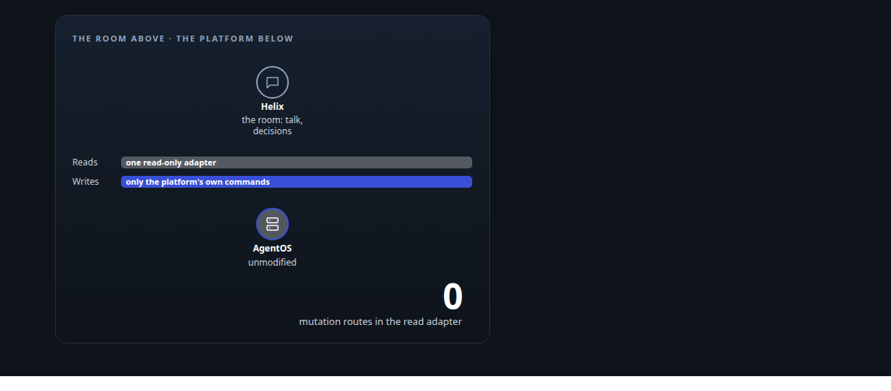
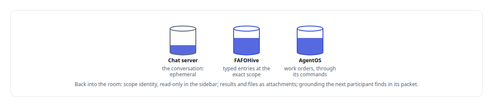
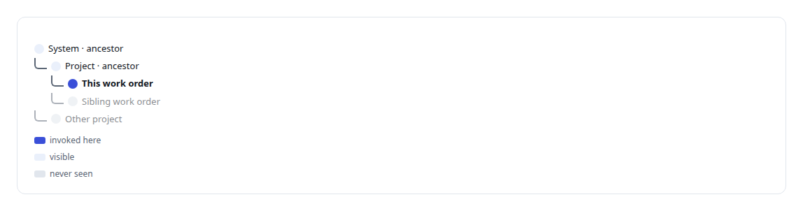
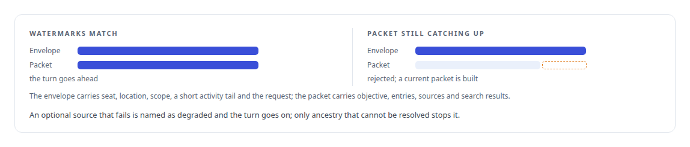

# From a conversation to a work order

**Helix wraps my governance platform without modifying it: talk happens in the room, durable work goes through the platform's own commands, and results come back**

Canonical: https://coreyjames.ai/stories/from-a-conversation-to-a-work-order/  
Author: Corey James · Published: 2026-10-28 · Kind: story  
DOI: https://doi.org/10.5281/zenodo.23735146 (this page is a chapter of the system's report)  
Systems: [Helix](https://github.com/coreyjames-ai/helix) · [AgentOS](https://github.com/coreyjames-ai/agentos) · [FAFOHive](https://github.com/coreyjames-ai/fafohive)  
Technologies: [Context engineering and persistent agent memory](https://github.com/coreyjames-ai/portfolio/tree/main/technologies/context-engineering-and-persistent-agent-memory) · [Governed AI-assisted software engineering](https://github.com/coreyjames-ai/portfolio/tree/main/technologies/governed-ai-assisted-software-engineering) · [Model Context Protocol (MCP)](https://github.com/coreyjames-ai/portfolio/tree/main/technologies/model-context-protocol-mcp) · [PostgreSQL](https://github.com/coreyjames-ai/portfolio/tree/main/technologies/postgresql) · [Rust](https://github.com/coreyjames-ai/portfolio/tree/main/technologies/rust)  
Skills: [agent orchestration](https://github.com/coreyjames-ai/portfolio/tree/main/skills/agent-orchestration) · [tool synthesis and governed API integration](https://github.com/coreyjames-ai/portfolio/tree/main/skills/tool-synthesis-and-governed-api-integration) · [multi-agent governance](https://github.com/coreyjames-ai/portfolio/tree/main/skills/multi-agent-governance) · [AI-assisted engineering methodology](https://github.com/coreyjames-ai/portfolio/tree/main/skills/ai-assisted-engineering-methodology)  



## Result

| Figure | What it measures |
| --- | --- |
| **1** | platform system at a time, imported by its exact id |
| **3** | kinds of result that come back into the room |

## What was built

A conversation is where decisions get made. A work order is where work gets done. Helix sits between the two, and the rule that shapes it is written at the top of its charter: it is a wrapper over my governance platform, AgentOS. It consumes the platform's binaries, command line and work graph, and it never modifies them. Durable work and durable knowledge go to the platform's own primitives, work orders, the work graph and the memory service. Ephemeral conversation stays in the interface layer.

## Two directions

Work can start on either side. Starting in Helix, the operator creates planning-only systems, projects and work orders, each with its channels, files and grounding. When a work order is later applied through the platform's own authoring command, Helix binds the exact ids that command returns to the scopes it already had. Starting from the platform, the operator selects an existing system by its exact id. Helix imports its whole current tree of projects and work orders and from then on projects new children read-only. Links are never inferred from names or paths, and general discovery is deliberately switched off.

## The boundary

Every read of the platform goes through the read-only adapter, with constant-time bearer authentication and bounded blocking reads. If a platform source goes missing, Helix shows it as missing or unavailable and deletes none of its own history.

## What stays where



## Context that follows the scope

Every conversation sits at a canonical scope, a system, a project, a work order, or a participant's private conversation. Channels and threads are activity streams inside a scope, never scopes themselves. Retrieval follows the level of invocation, and writes go only to the exact current scope.




Each turn, the bridge builds an immutable envelope around a grounding packet, stamped with revision watermarks so a model can tell a current packet from one still catching up. An envelope whose revision does not match its packet is rejected.



This design is one of my filed inventions, described at explainer depth in [Family Three](https://coreyjames.ai/research/family-three-unified-context-across-models/).

## The conversation becomes the work order

When a council ratifies an outcome, the operator can continue it in a mode that builds the implementation plan. The same seats author the human-readable plan and the canonical work-order document against the platform's existing authoring packet, and validate it with the platform's own render-and-validate command, which checks the package without applying it. The owner applies it later, as a separate and deliberate step. No new work-order format, tool or authoring path was created for this; the council produces what the platform already accepts. The council side is in [Three councils I threw away](https://coreyjames.ai/stories/three-councils-i-threw-away).

## Delegation without a council

Ordinary work does not need a council or a work order. A Teams user, or the voice agent on their behalf, can delegate a task to a containerised worker running a frontier model's authenticated session, locally or as an on-demand cloud job. Ownership comes from the Microsoft sign-in, hosts are outbound-only, credentials are minted per execution, and the job is observed and cancellable from the chat. The cloud path runs under the same daily budget gate as everything else, described in [One call to a GPU anywhere](https://coreyjames.ai/stories/one-call-to-a-gpu-anywhere).

## What this demonstrates

I can join a conversational layer to a governance platform and hold a hard line between them: reads through one door, writes through the platform's own commands, and knowledge scoped so that a model sees exactly what its level of the tree entitles it to.

I set the wrapper doctrine, the scope model and the read-only boundary, and directed AI coding agents, a mix of frontier and open-source models, that implemented them under my governance system.

> There is never estate-wide retrieval by omission.

## What was verified

Each line is a claim the canonical page supports, with the figure as the page states it.

- Agent orchestration: a chat room that turns a conversation into a governed work order through the platform's own commands, never by writing to its database.
- Scoped retrieval for AI agents: context retrieved at the level of invocation, never estate-wide by omission, with writes only to the exact current scope.
- Grounding and context assembly: an immutable per-turn envelope carrying a grounding packet stamped with a revision watermark, rejected when the two disagree.
- Graceful degradation: only unresolvable ancestry is fatal; other memory sources degrade by name and the conversation carries on.

## Related

- [Three councils I threw away](https://github.com/coreyjames-ai/helix/tree/main/stories/three-councils-i-threw-away) · https://coreyjames.ai/stories/three-councils-i-threw-away/
- [Why long agent runs fail](https://github.com/coreyjames-ai/agentos/tree/main/stories/why-long-agent-runs-fail) · https://coreyjames.ai/stories/why-long-agent-runs-fail/
- [Closed by evidence](https://github.com/coreyjames-ai/agentos/tree/main/stories/closed-by-evidence) · https://coreyjames.ai/stories/closed-by-evidence/
- [One call to a GPU anywhere](https://github.com/coreyjames-ai/fafo-core/tree/main/stories/one-call-to-a-gpu-anywhere) · https://coreyjames.ai/stories/one-call-to-a-gpu-anywhere/
- [Family Three: Unified context across AI models and knowledge systems](https://github.com/coreyjames-ai/portfolio/tree/main/research/patent-families/family-three-unified-context-across-models) · https://coreyjames.ai/research/family-three-unified-context-across-models/

## Citation

Corey James. "From a conversation to a work order." coreyjames.ai, 2026. https://coreyjames.ai/stories/from-a-conversation-to-a-work-order/ In: the Helix technical report, doi:10.5281/zenodo.23735146.

```bibtex
@misc{coreyjames-from-a-conversation-to-a-work-order,
  author = {Corey James},
  title = {From a conversation to a work order},
  year = {2026},
  howpublished = {\url{https://coreyjames.ai/stories/from-a-conversation-to-a-work-order/}},
  note = {GitHub copy: https://github.com/coreyjames-ai/helix/tree/main/stories/from-a-conversation-to-a-work-order},
  doi = {10.5281/zenodo.23735146}
}
```

Part of [Helix](https://github.com/coreyjames-ai/helix) and [Corey James's portfolio](https://github.com/coreyjames-ai/portfolio) · site: https://coreyjames.ai/ · MCP server: https://coreyjames.ai/mcp · agent card: https://coreyjames.ai/.well-known/agent.json
