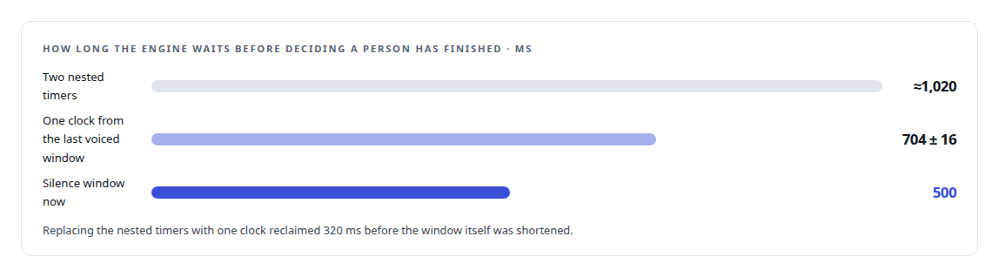
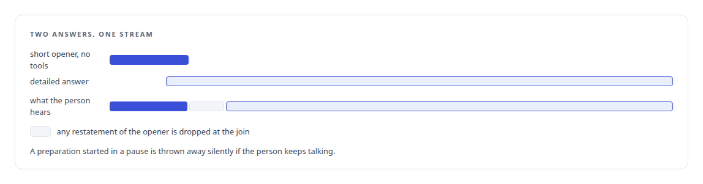
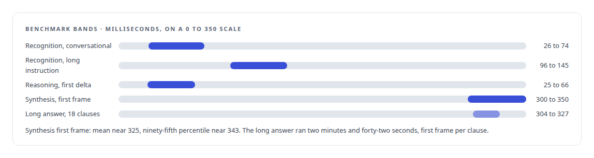

# From two seconds to under one

**Question to first sound, taken apart stage by stage: the silence window, recognition, reasoning, the first spoken sentence and synthesis, each cut named and each benchmark row carrying its own definition**

Canonical: https://coreyjames.ai/stories/from-two-seconds-to-under-one/  
Author: Corey James · Published: 2026-10-28 · Kind: story  
DOI: https://doi.org/10.5281/zenodo.23735146 (this page is a chapter of the system's report)  
Systems: [Helix](https://github.com/coreyjames-ai/helix)  
Technologies: [Conversational turn-taking and barge-in](https://github.com/coreyjames-ai/portfolio/tree/main/technologies/conversational-turn-taking-and-barge-in) · [Performance engineering and benchmarking](https://github.com/coreyjames-ai/portfolio/tree/main/technologies/performance-engineering-and-benchmarking) · [Real-time audio pipeline engineering](https://github.com/coreyjames-ai/portfolio/tree/main/technologies/real-time-audio-pipeline-engineering) · [Speech recognition model](https://github.com/coreyjames-ai/portfolio/tree/main/technologies/speech-recognition-model)  
Skills: [AI-assisted engineering methodology](https://github.com/coreyjames-ai/portfolio/tree/main/skills/ai-assisted-engineering-methodology) · [real-time voice AI](https://github.com/coreyjames-ai/portfolio/tree/main/skills/real-time-voice-ai)  


## Result

| Figure | What it measures |
| --- | --- |
| **400 ms** | cut at most on complex answers by keeping the first sentence short, 300 at least |
| **5,668** | turns in a ten-minute loopback soak, every one processed |
| **96 KB** | memory growth across that soak |

## What was built

A spoken assistant is judged by one interval: the gap between the moment a person stops talking and the moment they hear a reply begin. In the voice engine's first working version that gap was more than twice what it is now.

## The stages

Before the work, the chain was roughly: 700 milliseconds of silence before the engine decided the person had finished, about a second for speech recognition on the CPU, a few tens of milliseconds for the reasoning model's first words, and about 310 milliseconds for the synthesiser's first frame of audio, with the first sentence having to complete before it could be spoken.

The silence window went from 700 milliseconds to 500, after an earlier fix had found two silence timers nested so the engine waited for one and then the other.



 Recognition moved to a GPU and dropped from about a second to between 38 and 74 milliseconds, with the correctness catch told in [Fast transcripts that were wrong](https://coreyjames.ai/stories/fast-transcripts-that-were-wrong). The speech contract was given a rule that the first sentence is short and direct, because first audio waits on the first sentence. The synthesiser was taught to stream, in [Building the streaming my speech model did not ship](https://coreyjames.ai/stories/building-the-streaming-my-speech-model-did-not-ship), and the lines an assistant says most often were pre-rendered, in [Three hundred milliseconds of hello](https://coreyjames.ai/stories/three-hundred-milliseconds-of-hello).


## Starting before the person has finished

Two mechanisms work on the gap from the other side. The engine begins preparing an answer after a brief pause rather than waiting for the full silence window, and silently discards that preparation if the person resumes, so a hesitating speaker is never cut off and a finished one is answered sooner. And two answers are generated together: a short opener that needs no tools, and the detailed answer, joined into one stream with any restatement dropped, so a person hears something within the first few hundred milliseconds while the detail is still being produced. An earlier design speculated on the audio itself rather than the text, and two synthesis streams sharing one synthesiser starved the active one into chopped audio; speculation is now text only, replayed into the unchanged pipeline when the turn is granted.



## A number must name its row

Every figure in the engine's benchmark file carries its definition: what was measured from which event to which, on which path, warm or cold. 



## What this demonstrates

I do latency work as decomposition: the gap named stage by stage, each cut made where it belonged, the stages that overlap made to overlap, and every number tied to the row that defines it.

The decomposition and the speech-contract rule were mine; AI coding agents, a mix of frontier and open-source models, implemented and measured each stage under my governance system.

> Nothing about the reply got shorter. The gap was taken apart into its stages.

## What was verified

Each line is a claim the canonical page supports, with the figure as the page states it.

- Latency engineering for voice AI: question to first sound taken apart stage by stage and cut from about two seconds to under one.
- Response shaping for voice: keeping the first spoken sentence short cut 300 to 400 ms on complex answers.
- Soak testing and memory stability: 5,668 turns in a ten-minute loopback soak, every one processed, with 96 KB of memory growth.
- Performance benchmarking methodology: every figure in the benchmark file tied to its own row and definition, from which event to which, warm or cold.

## Related

- [Fast transcripts that were wrong](https://github.com/coreyjames-ai/helix/tree/main/stories/fast-transcripts-that-were-wrong) · https://coreyjames.ai/stories/fast-transcripts-that-were-wrong/
- [Building the streaming my speech model did not ship](https://github.com/coreyjames-ai/helix/tree/main/stories/building-the-streaming-my-speech-model-did-not-ship) · https://coreyjames.ai/stories/building-the-streaming-my-speech-model-did-not-ship/
- [Three hundred milliseconds of hello](https://github.com/coreyjames-ai/helix/tree/main/stories/three-hundred-milliseconds-of-hello) · https://coreyjames.ai/stories/three-hundred-milliseconds-of-hello/

## Citation

Corey James. "From two seconds to under one." coreyjames.ai, 2026. https://coreyjames.ai/stories/from-two-seconds-to-under-one/ In: the Helix technical report, doi:10.5281/zenodo.23735146.

```bibtex
@misc{coreyjames-from-two-seconds-to-under-one,
  author = {Corey James},
  title = {From two seconds to under one},
  year = {2026},
  howpublished = {\url{https://coreyjames.ai/stories/from-two-seconds-to-under-one/}},
  note = {GitHub copy: https://github.com/coreyjames-ai/helix/tree/main/stories/from-two-seconds-to-under-one},
  doi = {10.5281/zenodo.23735146}
}
```

Part of [Helix](https://github.com/coreyjames-ai/helix) and [Corey James's portfolio](https://github.com/coreyjames-ai/portfolio) · site: https://coreyjames.ai/ · MCP server: https://coreyjames.ai/mcp · agent card: https://coreyjames.ai/.well-known/agent.json
