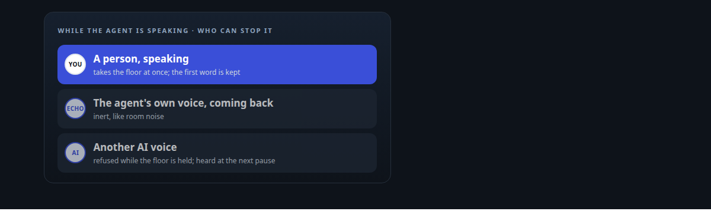
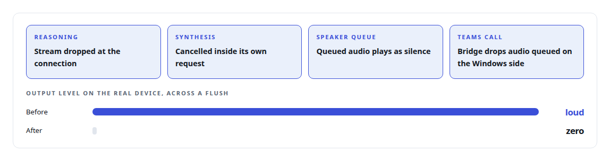
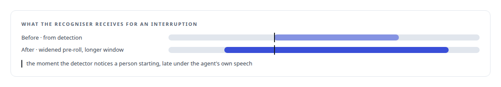
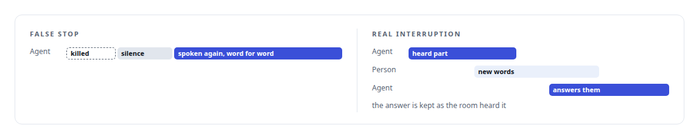

# Interruptions that only people can make

**Echo sounded like a person to the detector; the rules were set so a person always wins the floor, the agent's own voice never does, the first word of an interruption is heard, and a false stop re-speaks instead of going quiet**

Canonical: https://coreyjames.ai/stories/interruptions-that-only-people-can-make/  
Author: Corey James · Published: 2026-10-28 · Kind: story  
DOI: https://doi.org/10.5281/zenodo.23735146 (this page is a chapter of the system's report)  
Systems: [Helix](https://github.com/coreyjames-ai/helix)  
Technologies: [Conversational turn-taking and barge-in](https://github.com/coreyjames-ai/portfolio/tree/main/technologies/conversational-turn-taking-and-barge-in) · [Real-time audio pipeline engineering](https://github.com/coreyjames-ai/portfolio/tree/main/technologies/real-time-audio-pipeline-engineering) · [Rust](https://github.com/coreyjames-ai/portfolio/tree/main/technologies/rust)  
Skills: [real-time voice AI](https://github.com/coreyjames-ai/portfolio/tree/main/skills/real-time-voice-ai)  



## Result

| Figure | What it measures |
| --- | --- |
| **18** | attack cases in an adversarial review before anyone heard the feature |
| **1** | device period of audio, at most, left after a flush |
| **0 s** | of dead air after a false stop: the answer is spoken again |

## What was built

A voice assistant that cannot be interrupted is a lecture. One that can be interrupted by its own echo is worse, because it stops mid-sentence for nobody. The voice engine runs full duplex, listening while it speaks, and the design problem is to make a person's interruption instant and everything else inert.

## What stops the agent

While the agent is listening, it starts a turn the moment speech begins. While it is speaking, it is harder to stop: an interruption has to be sustained speech with a confidence the detector measures, because residual echo and room noise come back as brief, low-confidence bursts and a person does not. The threshold was set from measurement: in real sessions the agent's own echo scored well below the floor and real interruptions well above it, after a phantom interruption had killed an answer mid-sentence.


When an interruption is confirmed, everything stale is cancelled at once, at every stage of the path.



## Hearing the first word

Under the agent's own speech, the detector is slower to notice a person starting, which clips the first word of whatever they said. So an interrupting sentence gets a longer listening window than a normal turn, because its first words sit on echo and the recogniser needs the whole phrase as context. That change removed the "inaudible" fragments the recogniser had been returning for interruptions.



## When the interruption was not real

A confirmed interruption that killed an answer before any audio played, followed by a silent room, is treated as a phantom.



## Several voices in one room

The same discipline governs rooms with several AI voices. A specialist whose work finishes while someone else is speaking queues a line and is heard at the next pause, in arrival order, never by cutting in. A spoken hand-off from the facilitator to a named specialist is the dispatch itself, and names are matched with the ways a recogniser mishears them. An adversarial review found, before anyone heard the feature, that a specialist's error could kill the whole meeting and that a hand-back could not be interrupted, and both now have their own tests.

## What this demonstrates

I treat interruption as a measured property rather than a feature flag: cancellation that reaches every stage including the far end of a cloud call, and recovery for the case where the detector was wrong.

The behaviour and the measurement rules were mine; AI coding agents, a mix of frontier and open-source models, implemented them under my governance system.

> The agent's own voice can never take the floor from a person.

## What was verified

Each line is a claim the canonical page supports, with the figure as the page states it.

- Barge-in and turn-taking for voice AI: a person can always take the floor, while the agent's own echo and other AI voices cannot.
- Adversarial review of AI features: 18 attack cases reviewed before anyone heard the interruption feature.
- Real-time audio cancellation: one confirmed interruption cancels reasoning, synthesis, the speaker queue and the Teams call together.
- Recovery from false positives: a stop nobody made leaves 0 s of dead air, because the killed answer is spoken again word for word.

## Related

- [A proof that proved nothing](https://github.com/coreyjames-ai/helix/tree/main/stories/a-proof-that-proved-nothing) · https://coreyjames.ai/stories/a-proof-that-proved-nothing/
- [Listen only to me](https://github.com/coreyjames-ai/helix/tree/main/stories/listen-only-to-me) · https://coreyjames.ai/stories/listen-only-to-me/
- [A self-hosted colleague in a Teams call](https://github.com/coreyjames-ai/helix/tree/main/stories/a-self-hosted-colleague-in-a-teams-call) · https://coreyjames.ai/stories/a-self-hosted-colleague-in-a-teams-call/

## Citation

Corey James. "Interruptions that only people can make." coreyjames.ai, 2026. https://coreyjames.ai/stories/interruptions-that-only-people-can-make/ In: the Helix technical report, doi:10.5281/zenodo.23735146.

```bibtex
@misc{coreyjames-interruptions-that-only-people-can-make,
  author = {Corey James},
  title = {Interruptions that only people can make},
  year = {2026},
  howpublished = {\url{https://coreyjames.ai/stories/interruptions-that-only-people-can-make/}},
  note = {GitHub copy: https://github.com/coreyjames-ai/helix/tree/main/stories/interruptions-that-only-people-can-make},
  doi = {10.5281/zenodo.23735146}
}
```

Part of [Helix](https://github.com/coreyjames-ai/helix) and [Corey James's portfolio](https://github.com/coreyjames-ai/portfolio) · site: https://coreyjames.ai/ · MCP server: https://coreyjames.ai/mcp · agent card: https://coreyjames.ai/.well-known/agent.json
