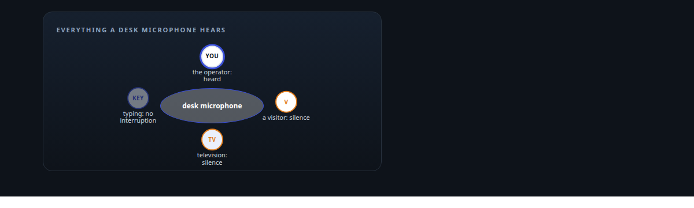
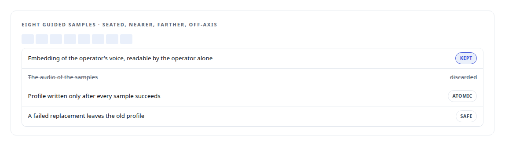
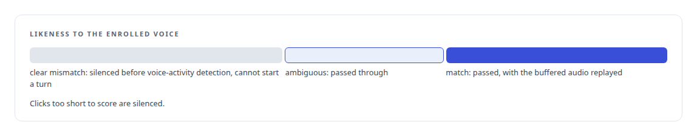
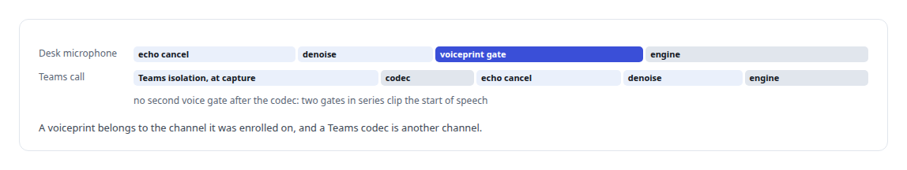

# Listen only to me

**An opt-in filter for a desk microphone that hears its operator and not the television, enrolled without keeping a recording, switched by asking, and deliberately not used on Teams, with the reasons written down**

Canonical: https://coreyjames.ai/stories/listen-only-to-me/  
Author: Corey James · Published: 2026-10-28 · Kind: story  
Systems: [Helix](https://github.com/coreyjames-ai/helix)  
Technologies: [Applied cryptography](https://github.com/coreyjames-ai/portfolio/tree/main/technologies/applied-cryptography) · [Conversational turn-taking and barge-in](https://github.com/coreyjames-ai/portfolio/tree/main/technologies/conversational-turn-taking-and-barge-in) · [Real-time audio pipeline engineering](https://github.com/coreyjames-ai/portfolio/tree/main/technologies/real-time-audio-pipeline-engineering) · [Rust](https://github.com/coreyjames-ai/portfolio/tree/main/technologies/rust)  



## Result

| Figure | What it measures |
| --- | --- |
| **8 × 8 s** | guided enrolment samples, none of them kept |
| **3** | policies: open, shadow and locked |

## What was built

A desk microphone hears everything in the room: the operator, a visitor, the television, loud typing. An assistant that can take actions on a spoken word should know whose word it is. The voice engine has an optional voiceprint filter that recognises the operator's voice and silences every other voice before the engine can hear it, so another speaker cannot interrupt the agent, be transcribed, or trigger a tool.

## Enrolment without a recording

Enrolment covers the ways a person actually sits at a desk, through the same echo cancellation and denoising the engine applies to speech, so the profile matches what the engine will hear.



## What the filter decides

Incoming audio is scored against the enrolled profile, and the decision is one of three.



The ambiguous case is passed because the filter's job is to keep strangers out.


## Switched by asking

The filter has three policies: open, shadow and locked. The operator changes them by speaking. "Listen only to me" locks it; "Let my wife talk to you too" opens it. The model interprets the request, the engine applies it deterministically through a native tool, and the assistant confirms aloud. A command-line tool is the recovery path, and a locked filter with a missing or corrupt profile fails loudly rather than opening silently. In the field, the operator was recognised while walking around the room.

## Why not on Teams

The filter runs on the desk microphone only. In a Teams call the engine relies on Microsoft's native voice isolation at the capture device, and the decision is written down with its reasons.



## What this demonstrates

I design privacy-sensitive capabilities with their boundaries explicit: enrolled without keeping audio, biased toward hearing the operator, switchable by voice with a loud failure mode, and kept off the surface where it would do harm, with the reasoning written where the next engineer will find it.

The enrolment rule, the ambiguity rule and the Teams decision were mine; AI coding agents, a mix of frontier and open-source models, implemented the filter under my governance system.

> The cost of silencing the operator is higher than the cost of admitting a doubtful burst.

## What was verified

Each line is a claim the canonical page supports, with the figure as the page states it.

- Speaker verification for voice AI: an opt-in voiceprint filter that hears its operator and silences other voices, enrolled from 8 guided samples with no recording kept.
- Privacy-preserving design: enrolment keeps an embedding and discards the audio, and the profile is written atomically and readable by the operator alone.
- Voice-controlled policy: 3 filter policies switched by asking, with a locked filter failing loudly when its profile is missing.

## Related

- [Interruptions that only people can make](https://github.com/coreyjames-ai/helix/tree/main/stories/interruptions-that-only-people-can-make) · https://coreyjames.ai/stories/interruptions-that-only-people-can-make/
- [A self-hosted colleague in a Teams call](https://github.com/coreyjames-ai/helix/tree/main/stories/a-self-hosted-colleague-in-a-teams-call) · https://coreyjames.ai/stories/a-self-hosted-colleague-in-a-teams-call/
- [A proof that proved nothing](https://github.com/coreyjames-ai/helix/tree/main/stories/a-proof-that-proved-nothing) · https://coreyjames.ai/stories/a-proof-that-proved-nothing/

## Citation

Corey James. "Listen only to me." coreyjames.ai, 2026. https://coreyjames.ai/stories/listen-only-to-me/

```bibtex
@misc{coreyjames-listen-only-to-me,
  author = {Corey James},
  title = {Listen only to me},
  year = {2026},
  howpublished = {\url{https://coreyjames.ai/stories/listen-only-to-me/}},
  note = {GitHub copy: https://github.com/coreyjames-ai/helix/tree/main/stories/listen-only-to-me}
}
```

Part of [Helix](https://github.com/coreyjames-ai/helix) and [Corey James's portfolio](https://github.com/coreyjames-ai/portfolio) · site: https://coreyjames.ai/ · MCP server: https://coreyjames.ai/mcp · agent card: https://coreyjames.ai/.well-known/agent.json
