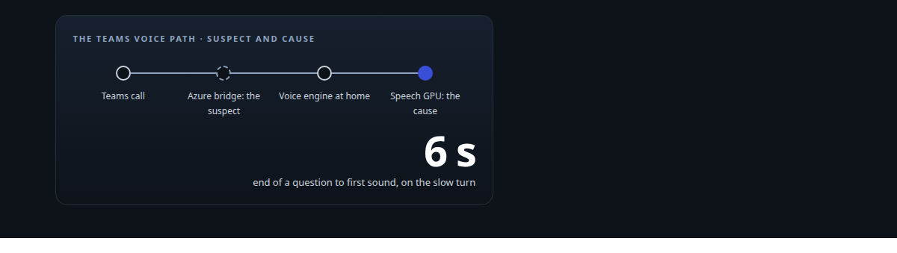
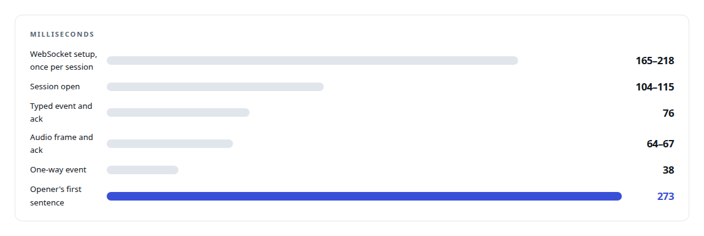
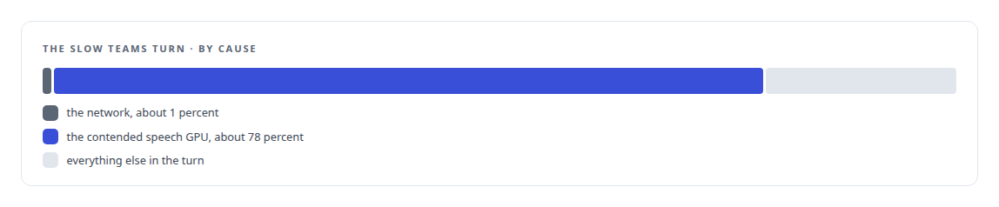
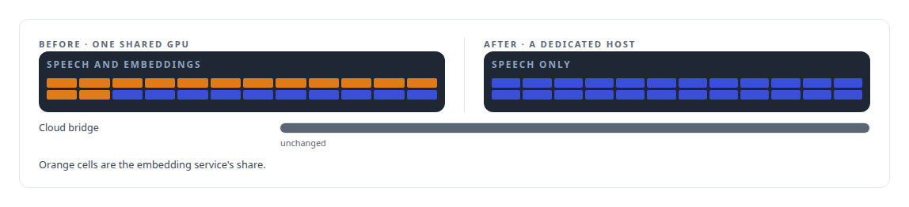

# One percent network, seventy-eight percent GPU

**A slow Teams turn was blamed on the cloud hop; measurement showed the network was about one percent of it and a speech GPU shared with an embedding service was most of the rest, so the compute moved and the cloud stayed**

Canonical: https://coreyjames.ai/stories/one-percent-network-seventy-eight-percent-gpu/  
Author: Corey James · Published: 2026-10-28 · Kind: story  
DOI: https://doi.org/10.5281/zenodo.23735146 (this page is a chapter of the system's report)  
Systems: [Helix](https://github.com/coreyjames-ai/helix)  
Technologies: [GPU admission control and co-residency](https://github.com/coreyjames-ai/portfolio/tree/main/technologies/gpu-admission-control-and-co-residency) · [Microsoft real-time media SDK](https://github.com/coreyjames-ai/portfolio/tree/main/technologies/microsoft-real-time-media-sdk) · [Performance engineering and benchmarking](https://github.com/coreyjames-ai/portfolio/tree/main/technologies/performance-engineering-and-benchmarking) · [Real-time audio pipeline engineering](https://github.com/coreyjames-ai/portfolio/tree/main/technologies/real-time-audio-pipeline-engineering)  
Skills: [Microsoft Teams real-time media](https://github.com/coreyjames-ai/portfolio/tree/main/skills/microsoft-teams-real-time-media) · [speech recognition and synthesis pipelines](https://github.com/coreyjames-ai/portfolio/tree/main/skills/speech-recognition-and-synthesis-pipelines) · [AI-assisted engineering methodology](https://github.com/coreyjames-ai/portfolio/tree/main/skills/ai-assisted-engineering-methodology) · [real-time voice AI](https://github.com/coreyjames-ai/portfolio/tree/main/skills/real-time-voice-ai)  



## Result

| Figure | What it measures |
| --- | --- |
| **65 ms** | round trip between the cloud bridge and the home lab |
| **1.317 s** | end of speech to first reply audio on a responsive Teams turn |
| **100%** | speech GPU utilisation at peak in the slow window, never below 95 |
| **5,859** | frames validated in a closed-loop call, zero rejects |

## What was built

The Teams voice path crosses a cloud: audio leaves Microsoft's media platform, reaches a Windows bridge on an Azure virtual machine, and crosses an authenticated WebSocket to the voice engine on my own hardware, then back. When a Teams turn took about six seconds from the end of a question to the first sound of the answer, the cloud hop was the obvious suspect.


## Measuring the transport

The transport was measured on its own first.



The bridge's own numbers were sound. A thirty-minute soak carried 91,643 receive buffers at 50.001 per second with zero stalls, one send stall and no reconnects. A forced reconnect mid-call resumed the same session after one 250-millisecond retry with both call legs alive, and the 36 audio callbacks that landed during the break were dropped rather than replayed, so the agent never answered a question from before the gap.

None of that explains six seconds.

## Where the six seconds went

The slow turn was decomposed with the same per-stage discipline as the local chain in [From two seconds to under one](https://coreyjames.ai/stories/from-two-seconds-to-under-one). Recognition took 253 milliseconds. The synthesiser took 4.847 seconds from receiving its text to its first frame of audio, and inside that were two serialised waits of 12.4 and 4.1 seconds across clauses.



## What moved

Speech synthesis moved to a GPU host of its own, and the cloud bridge stayed where it was.



That decision would have gone the other way without the measurement: a faster network path would have bought one percent, and an engineer who trusted the obvious story would have spent a week on it.

## What this demonstrates

I resist the obvious attribution: the cloud hop was measured, found cheap and left alone, and the real cost was fixed by moving one service.

The decision to measure before moving anything was mine; AI coding agents, a mix of frontier and open-source models, ran the benchmark and the move under my governance system.

> The obvious suspect was wrong.

## What was verified

Each line is a claim the canonical page supports, with the figure as the page states it.

- Performance diagnosis: a slow Teams turn blamed on the cloud hop measured at about one percent network and about seventy-eight percent contended speech GPU.
- Latency measurement: per-stage timing of a Teams turn, recognition at 253 ms and synthesis at 4.847 s to first frame, before synthesis moved to a GPU of its own.
- Microsoft Teams real-time media: a cloud bridge carrying 91,643 buffers at 50.001 per second with zero stalls and a 65 ms round trip to the home lab.
- Closed-loop media validation: 5,859 frames validated in a closed-loop call with zero rejects.

## Related

- [A self-hosted colleague in a Teams call](https://github.com/coreyjames-ai/helix/tree/main/stories/a-self-hosted-colleague-in-a-teams-call) · https://coreyjames.ai/stories/a-self-hosted-colleague-in-a-teams-call/
- [From two seconds to under one](https://github.com/coreyjames-ai/helix/tree/main/stories/from-two-seconds-to-under-one) · https://coreyjames.ai/stories/from-two-seconds-to-under-one/
- [Building the streaming my speech model did not ship](https://github.com/coreyjames-ai/helix/tree/main/stories/building-the-streaming-my-speech-model-did-not-ship) · https://coreyjames.ai/stories/building-the-streaming-my-speech-model-did-not-ship/

## Citation

Corey James. "One percent network, seventy-eight percent GPU." coreyjames.ai, 2026. https://coreyjames.ai/stories/one-percent-network-seventy-eight-percent-gpu/ In: the Helix technical report, doi:10.5281/zenodo.23735146.

```bibtex
@misc{coreyjames-one-percent-network-seventy-eight-percent-gpu,
  author = {Corey James},
  title = {One percent network, seventy-eight percent GPU},
  year = {2026},
  howpublished = {\url{https://coreyjames.ai/stories/one-percent-network-seventy-eight-percent-gpu/}},
  note = {GitHub copy: https://github.com/coreyjames-ai/helix/tree/main/stories/one-percent-network-seventy-eight-percent-gpu},
  doi = {10.5281/zenodo.23735146}
}
```

Part of [Helix](https://github.com/coreyjames-ai/helix) and [Corey James's portfolio](https://github.com/coreyjames-ai/portfolio) · site: https://coreyjames.ai/ · MCP server: https://coreyjames.ai/mcp · agent card: https://coreyjames.ai/.well-known/agent.json
