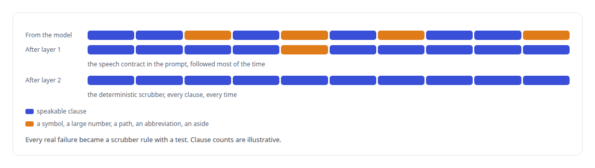
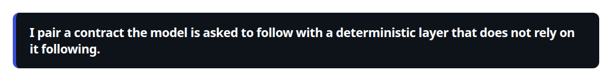
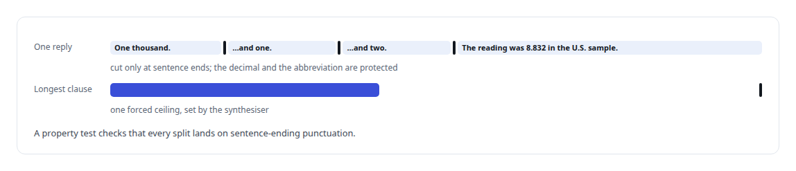

# Saying numbers out loud

**A chemical formula came out as a sneeze and a thousand as ten thousand; a speech contract and a deterministic scrubber give the voice speakable text while the screen keeps the written answer**

Canonical: https://coreyjames.ai/stories/saying-numbers-out-loud/  
Author: Corey James · Published: 2026-10-28 · Kind: story  
DOI: https://doi.org/10.5281/zenodo.23735146 (this page is a chapter of the system's report)  
Systems: [Helix](https://github.com/coreyjames-ai/helix)  
Technologies: [Conversational turn-taking and barge-in](https://github.com/coreyjames-ai/portfolio/tree/main/technologies/conversational-turn-taking-and-barge-in) · [Rust](https://github.com/coreyjames-ai/portfolio/tree/main/technologies/rust)  
Skills: [speech recognition and synthesis pipelines](https://github.com/coreyjames-ai/portfolio/tree/main/skills/speech-recognition-and-synthesis-pipelines) · [AI-assisted engineering methodology](https://github.com/coreyjames-ai/portfolio/tree/main/skills/ai-assisted-engineering-methodology) · [inference serving architecture](https://github.com/coreyjames-ai/portfolio/tree/main/skills/inference-serving-architecture)  


## Result

| Figure | What it measures |
| --- | --- |
| **≈800** | lines in the deterministic scrubber |
| **500** | character ceiling on any clause, set by the synthesiser's own limits |

## What was built

A reasoning model writes for a screen. It writes "H₂O", "8.832", "abcdef.md", "U.S." and "1000", and every one of those is a trap for a synthesiser that speaks phonemes. In real use the formula for water came out as a sneeze, a thousand was spoken as ten thousand, a filename was read as a word, and the abbreviation for the country became "u dot s". Each is small. Together they are the difference between an assistant that sounds like a colleague and one that sounds like a machine reading a document.

## Two layers

The first layer is a speech contract in the prompt. The model follows it most of the time, and most of the time is not enough for speech.

The second layer is a deterministic scrubber that runs on every clause after the splitter and before synthesis. What a person reads is what the model wrote, and what they hear is what a person would say.





## Asides are never spoken

When a person interrupts and the agent's answer is cut off, the engine keeps the answer as the room heard it, so the model treats the interrupted question as addressed and answers only the new words. An early version marked the cut with a bracketed note, and the model started imitating the bracket aloud in later turns. The scrubber's bracket rule fixed that and a class of similar leaks at once.

## The counting bug

Asked to count from one thousand upward, the voice skipped and doubled numbers while the correct text reached the synthesiser. The cause was an alignment slip inside the model when many numbers arrived in one clause. The fix is in the contract, one item per sentence, which keeps each number in its own clause, and the clause splitter cuts only on sentence-ending punctuation with decimals and abbreviations protected, under a single forced ceiling that the synthesiser's own limits dictate.



## What this demonstrates

I close the gap between text that reads well and text that speaks well, and I do not trust a model to close it alone.

The say-and-show split and the contract were mine; AI coding agents, a mix of frontier and open-source models, built the scrubber and its tests under my governance system.

> I pair a contract the model is asked to follow with a deterministic layer that does not rely on it following.

## What was verified

Each line is a claim the canonical page supports, with the figure as the page states it.

- Speech synthesis pipelines: two layers between the model and the speaker, a prompt contract and a deterministic scrubber of about 800 lines on every clause.
- Text normalisation for TTS: formulas, large numbers, paths and abbreviations rewritten only for the voice, while subtitles and history keep what the model wrote.
- Property-based testing: every clause split checked to land on sentence-ending punctuation, under a 500-character ceiling.

## Related

- [The same brain, typed or spoken](https://github.com/coreyjames-ai/helix/tree/main/stories/the-same-brain-typed-or-spoken) · https://coreyjames.ai/stories/the-same-brain-typed-or-spoken/
- [Three hundred milliseconds of hello](https://github.com/coreyjames-ai/helix/tree/main/stories/three-hundred-milliseconds-of-hello) · https://coreyjames.ai/stories/three-hundred-milliseconds-of-hello/
- [Building the streaming my speech model did not ship](https://github.com/coreyjames-ai/helix/tree/main/stories/building-the-streaming-my-speech-model-did-not-ship) · https://coreyjames.ai/stories/building-the-streaming-my-speech-model-did-not-ship/

## Citation

Corey James. "Saying numbers out loud." coreyjames.ai, 2026. https://coreyjames.ai/stories/saying-numbers-out-loud/ In: the Helix technical report, doi:10.5281/zenodo.23735146.

```bibtex
@misc{coreyjames-saying-numbers-out-loud,
  author = {Corey James},
  title = {Saying numbers out loud},
  year = {2026},
  howpublished = {\url{https://coreyjames.ai/stories/saying-numbers-out-loud/}},
  note = {GitHub copy: https://github.com/coreyjames-ai/helix/tree/main/stories/saying-numbers-out-loud},
  doi = {10.5281/zenodo.23735146}
}
```

Part of [Helix](https://github.com/coreyjames-ai/helix) and [Corey James's portfolio](https://github.com/coreyjames-ai/portfolio) · site: https://coreyjames.ai/ · MCP server: https://coreyjames.ai/mcp · agent card: https://coreyjames.ai/.well-known/agent.json
