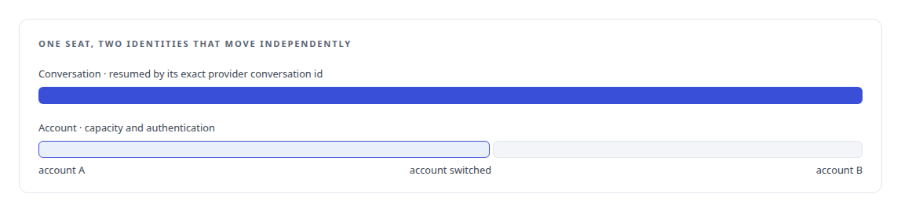
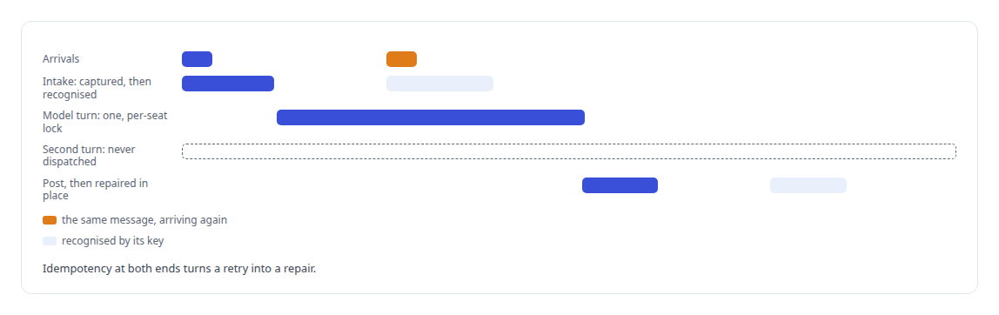
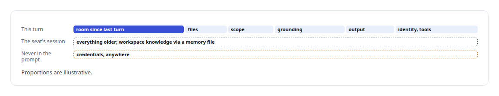

# Several minds in one room

**A team chat where humans and several model seats work together, each seat answering only when addressed, with no loop an agent can start**

Canonical: https://coreyjames.ai/stories/several-minds-in-one-room/  
Author: Corey James · Published: 2026-10-28 · Kind: story  
Systems: [Helix](https://github.com/coreyjames-ai/helix) · [FAFOHive](https://github.com/coreyjames-ai/fafohive)  
Technologies: [Context engineering and persistent agent memory](https://github.com/coreyjames-ai/portfolio/tree/main/technologies/context-engineering-and-persistent-agent-memory) · [Idempotency, exactly-once effects and crash recovery](https://github.com/coreyjames-ai/portfolio/tree/main/technologies/idempotency-exactly-once-effects-and-crash-recovery) · [Mattermost](https://github.com/coreyjames-ai/portfolio/tree/main/technologies/mattermost) · [PostgreSQL](https://github.com/coreyjames-ai/portfolio/tree/main/technologies/postgresql) · [Rust](https://github.com/coreyjames-ai/portfolio/tree/main/technologies/rust)  
Skills: [exactly-once delivery and crash recovery](https://github.com/coreyjames-ai/portfolio/tree/main/skills/exactly-once-delivery-and-crash-recovery) · [distributed systems correctness](https://github.com/coreyjames-ai/portfolio/tree/main/skills/distributed-systems-correctness) · [AI-assisted engineering methodology](https://github.com/coreyjames-ai/portfolio/tree/main/skills/ai-assisted-engineering-methodology) · [agent orchestration](https://github.com/coreyjames-ai/portfolio/tree/main/skills/agent-orchestration)  


## Result

| Figure | What it measures |
| --- | --- |
| **8** | fixed model seats, plus Helix itself |
| **3** | model families behind those seats |
| **30 s** | deadline for a prompt to appear in the provider's own transcript |

## What was built

Most AI chat is one person and one model in a private window. My work is a team: several people, several models from different families, documents on the table, and decisions that have to outlive the session. Helix puts all of that in one room on an open-source team chat server. Each model is a named participant with its own identity. A person addresses a seat the way they address a colleague, the seat answers in the right thread under its own name, and the room keeps the history.

## The shell is replaceable

The chat server runs unmodified from a pinned image, with its bundled calling and AI plugins switched off, so Helix is the only AI and voice authority in the room. Helix never writes to the server's database. It works through the server's REST and real-time APIs and keeps every fact it owns in its own PostgreSQL schema. I wrote down who owns which fact. Because of that split the server could be swapped for another and Helix would carry its state across.

A small plugin draws the workspace in the sidebar as a tree of systems, projects and work orders and hides the flat channel list. A node can own several channels. Each channel is a durable Helix conversation, and a thread is one topic inside it.

## What a seat is

Each model participant is backed by its own Rust service and is a frontier model's authenticated command-line session: launched under a persistent profile, resumed by its exact provider conversation id, and hosted in a supervised terminal session. Helix itself has a selectable reasoning backend for a brain, either a local model or a frontier profile. Account identity and conversation identity are separate. Switching the account behind a seat changes capacity and authentication, and the same conversation resumes with its visible history in place. Credentials never enter the database, the event log or a prompt.



## Who answers

The routing rules are short enough to state in full. An unaddressed human message in a mapped channel goes to Helix. A mention of a seat routes to exactly that seat, and Helix stays silent on a message meant for someone else. A top-level mention gets a top-level reply, a mention inside a thread gets a reply in that thread, and a direct message stays direct. Several mentions in one message fan out concurrently, each reply attributed to its seat. A post written by a bot never triggers another bot, which is the loop boundary outside a council.

Every post is captured into the shared history and the grounding projection whether or not the seat reading it later was the one addressed.



## What a model sees

A seat's turn is assembled from a bounded set of inputs, with attached files materialised locally, and nothing else reaches the prompt.




## Delivery is proven

Early on, a 66 KB prompt was pasted into one vendor's terminal tool and silently went nowhere. Now delivery counts only when the prompt appears as an observed event in the provider's own transcript, and that delivery deadline is separate from the unbounded time a model may spend reasoning. A different defect, where Helix answered a message meant for another seat and that seat's reply landed hidden in a thread, became a provider-neutral routing library that every seat now shares.

## Several humans

Authors are classified as human, Helix, participant agent or system. Any human's post is captured and may address Helix or a seat. Control actions, such as settings, the council builder, voice delegation and the terminal, are operator-only and checked against the operator's own session. Documents created in a conversation publish as native attachments with immutable versions, and a file marked for this message is never silently injected into future prompts; adding it to the library is a separate act.

## What this demonstrates

I can build a multi-model workspace that people and models share as equals in one room. Beside the Rust services, the plugin and web app are a further 23,000 lines of TypeScript and JavaScript.

I set the ownership split, the routing rules and the delivery rule, and directed AI coding agents, a mix of frontier and open-source models, that implemented them under my governance system.

> The room is the authority, and no model holds the shared state.

## What was verified

Each line is a claim the canonical page supports, with the figure as the page states it.

- Multi-agent collaboration systems: people and 8 fixed model seats from 3 model families working in one chat room, each seat answering only when addressed.
- Exactly-once delivery and crash recovery: intake and output keyed so a retry repairs a missing post and never runs a model turn twice.
- Context engineering for LLM agents: each turn assembled from a bounded set of inputs, older context left in the seat's own session, credentials never in a prompt.
- Delivery verification for agent prompts: a prompt counts as delivered only when it appears in the provider's own transcript within 30 s.

## Related

- [Three councils I threw away](https://github.com/coreyjames-ai/helix/tree/main/stories/three-councils-i-threw-away) · https://coreyjames.ai/stories/three-councils-i-threw-away/
- [The same brain, typed or spoken](https://github.com/coreyjames-ai/helix/tree/main/stories/the-same-brain-typed-or-spoken) · https://coreyjames.ai/stories/the-same-brain-typed-or-spoken/
- [From a conversation to a work order](https://github.com/coreyjames-ai/helix/tree/main/stories/from-a-conversation-to-a-work-order) · https://coreyjames.ai/stories/from-a-conversation-to-a-work-order/
- [A self-hosted colleague in a Teams call](https://github.com/coreyjames-ai/helix/tree/main/stories/a-self-hosted-colleague-in-a-teams-call) · https://coreyjames.ai/stories/a-self-hosted-colleague-in-a-teams-call/

## Citation

Corey James. "Several minds in one room." coreyjames.ai, 2026. https://coreyjames.ai/stories/several-minds-in-one-room/

```bibtex
@misc{coreyjames-several-minds-in-one-room,
  author = {Corey James},
  title = {Several minds in one room},
  year = {2026},
  howpublished = {\url{https://coreyjames.ai/stories/several-minds-in-one-room/}},
  note = {GitHub copy: https://github.com/coreyjames-ai/helix/tree/main/stories/several-minds-in-one-room}
}
```

Part of [Helix](https://github.com/coreyjames-ai/helix) and [Corey James's portfolio](https://github.com/coreyjames-ai/portfolio) · site: https://coreyjames.ai/ · MCP server: https://coreyjames.ai/mcp · agent card: https://coreyjames.ai/.well-known/agent.json
