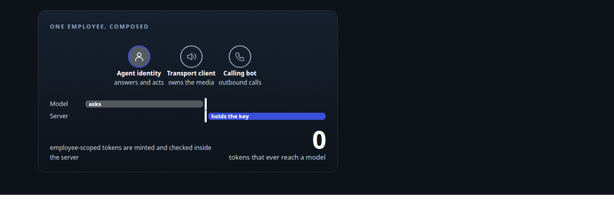
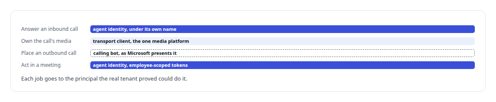
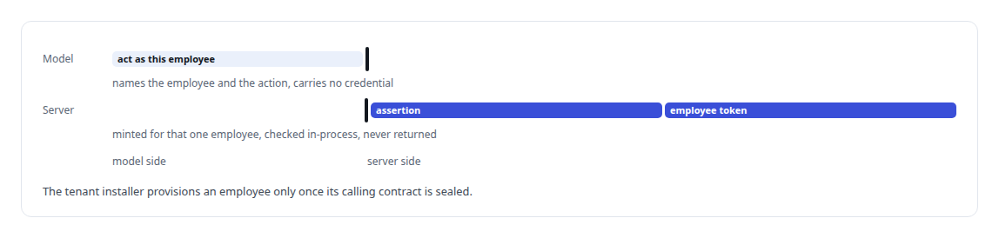

# Solving the digital-employee identity

**Working out, from real tenant evidence, how an AI employee can legitimately answer, call and act inside Microsoft 365**

Canonical: https://coreyjames.ai/stories/solving-the-digital-employee-identity/  
Author: Corey James · Published: 2026-10-28 · Kind: story  
DOI: https://doi.org/10.5281/zenodo.23735146 (this page is a chapter of the system's report)  
Systems: [Helix](https://github.com/coreyjames-ai/helix)  
Technologies: [Applied cryptography](https://github.com/coreyjames-ai/portfolio/tree/main/technologies/applied-cryptography) · [C#](https://github.com/coreyjames-ai/portfolio/tree/main/technologies/c-sharp) · [Identity and access management for AI agents](https://github.com/coreyjames-ai/portfolio/tree/main/technologies/identity-and-access-management-for-ai-agents) · [Microsoft Agent 365](https://github.com/coreyjames-ai/portfolio/tree/main/technologies/microsoft-agent-365) · [Microsoft Entra ID](https://github.com/coreyjames-ai/portfolio/tree/main/technologies/microsoft-entra-id) · [Microsoft Graph](https://github.com/coreyjames-ai/portfolio/tree/main/technologies/microsoft-graph) · [Microsoft Teams](https://github.com/coreyjames-ai/portfolio/tree/main/technologies/microsoft-teams) · [Model Context Protocol (MCP)](https://github.com/coreyjames-ai/portfolio/tree/main/technologies/model-context-protocol-mcp) · [React](https://github.com/coreyjames-ai/portfolio/tree/main/technologies/react) · [Rust](https://github.com/coreyjames-ai/portfolio/tree/main/technologies/rust) · [rmcp (Rust MCP SDK)](https://github.com/coreyjames-ai/portfolio/tree/main/technologies/rmcp-rust-mcp-sdk)  
Skills: [Microsoft 365, Graph and Entra integration](https://github.com/coreyjames-ai/portfolio/tree/main/skills/microsoft-365-graph-and-entra-integration) · [AI-assisted engineering methodology](https://github.com/coreyjames-ai/portfolio/tree/main/skills/ai-assisted-engineering-methodology) · [OAuth 2.0 and identity architecture](https://github.com/coreyjames-ai/portfolio/tree/main/skills/oauth-2-0-and-identity-architecture) · [tool synthesis and governed API integration](https://github.com/coreyjames-ai/portfolio/tree/main/skills/tool-synthesis-and-governed-api-integration)  



## Result

| Figure | What it measures |
| --- | --- |
| **3** | Microsoft principals, each with permissions the others lack |
| **1** | native media platform, owned by a transport-only client |

## What was built

Microsoft's Agent 365 lets an organisation give an AI a real identity in its tenant: a digital employee that can be called, join meetings and act under its own name. Making one actually do those things involves three different Microsoft principals, some combinations the platform rejects, and behaviour the documentation did not yet cover. I probed the real tenant, captured what the wire said, and composed the paths that work. The employee answers calls, joins meetings and shares its screen.

## The challenge

An identity that can answer an inbound call is not necessarily one that can place an outbound call, own a media session, or act in a meeting. Microsoft exposes the application identity, the agent identity and the calling bot as distinct principals, and the behaviour was preview-grade. I needed the employee to do all of it under its own name, without a shared super-account, with Microsoft remaining the authority on what it was allowed to do.



## Constraints

Preview behaviour that could only be learned by trying it. Tokens that never reach a model: the AI that reasons about a call must never hold the credential that makes the call. No shared super-account. And Microsoft as the permission authority, so my layer could not grant anything the tenant had not.

## My approach

Evidence over documentation. Every capability was probed against the real tenant with the wire traffic captured, and the design composed the paths that were proven to work instead of forcing one principal to do a job the platform rejected for it.

## What I built

A dual-client calling composition. The employee identity answers inbound calls under its own name; a transport-only client owns the single native media platform that the call audio flows through.

An MCP server for employee actions where every call names the employee it acts for, and the server mints employee-scoped Graph tokens through certificate assertions, checked in-process before use. The model asks for an action; the server holds the credential.



## Difficult decisions

Taking the platform's constraint on outbound calls. An outbound call from the employee presents to the recipient as a separate calling bot, because that is how Microsoft's model works. I could have made it appear to come from the employee.


## Results


## Technologies used

Microsoft Graph · Entra Agent ID · Agent 365 · C# · Rust MCP server · Certificate-based credentials · Identity and access management for AI agents

## What this demonstrates

I can work at the Microsoft 365 identity layer where the documentation runs out, from captured evidence, and build an identity design that keeps credentials away from the model and keeps the platform honest about who is acting.

I ran the probes, read the wire and designed the composition; AI coding agents, a mix of frontier and open-source models, implemented the server and installer under my direction. The identity platform is Microsoft's.

> An identity layer that spoofs is not an identity layer.

## What was verified

Each line is a claim the canonical page supports, with the figure as the page states it.

- Identity for AI agents in Microsoft 365 and Entra: a digital employee composed from 3 Microsoft principals, each job given to the principal the tenant itself proved could do it.
- Credential isolation for AI agents: the model asks for an action while the server mints and checks employee-scoped Graph tokens, so no token reaches the model.
- Microsoft Graph integration: an employee that answers calls, joins meetings, chats, presents and calls on raised hands under its own name.
- Evidence-led platform engineering: identity paths settled by probing the tenant and keeping the wire traffic where the documentation stopped.

## Related

- [A self-hosted colleague in a Teams call](https://github.com/coreyjames-ai/helix/tree/main/stories/a-self-hosted-colleague-in-a-teams-call) · https://coreyjames.ai/stories/a-self-hosted-colleague-in-a-teams-call/
- [A meeting attendee that will not fake it](https://github.com/coreyjames-ai/helix/tree/main/stories/a-meeting-attendee-that-will-not-fake-it) · https://coreyjames.ai/stories/a-meeting-attendee-that-will-not-fake-it/

## Citation

Corey James. "Solving the digital-employee identity." coreyjames.ai, 2026. https://coreyjames.ai/stories/solving-the-digital-employee-identity/ In: the Helix technical report, doi:10.5281/zenodo.23735146.

```bibtex
@misc{coreyjames-solving-the-digital-employee-identity,
  author = {Corey James},
  title = {Solving the digital-employee identity},
  year = {2026},
  howpublished = {\url{https://coreyjames.ai/stories/solving-the-digital-employee-identity/}},
  note = {GitHub copy: https://github.com/coreyjames-ai/helix/tree/main/stories/solving-the-digital-employee-identity},
  doi = {10.5281/zenodo.23735146}
}
```

Part of [Helix](https://github.com/coreyjames-ai/helix) and [Corey James's portfolio](https://github.com/coreyjames-ai/portfolio) · site: https://coreyjames.ai/ · MCP server: https://coreyjames.ai/mcp · agent card: https://coreyjames.ai/.well-known/agent.json
