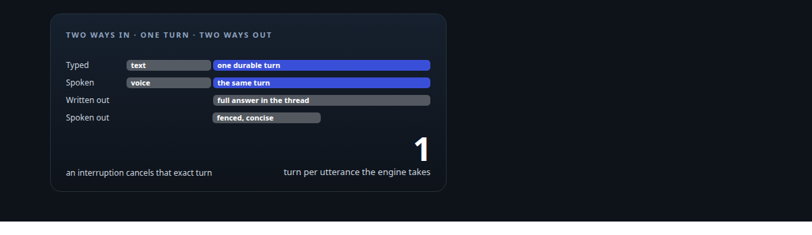
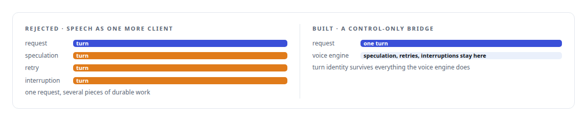
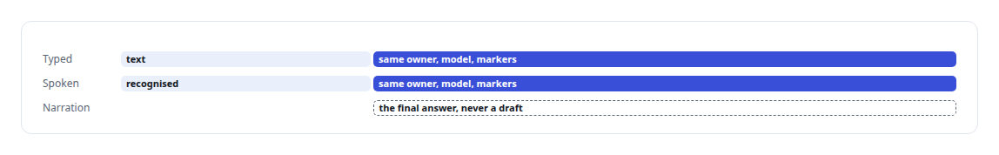
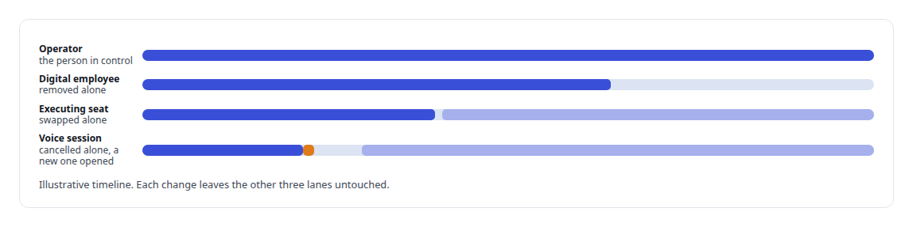

# The same brain, typed or spoken

**Why a spoken request and a typed request produce exactly one durable turn in the same conversation, and what it took to keep the two from drifting apart**

Canonical: https://coreyjames.ai/stories/the-same-brain-typed-or-spoken/  
Author: Corey James · Published: 2026-10-28 · Kind: story  
Systems: [Helix](https://github.com/coreyjames-ai/helix)  
Technologies: [Idempotency, exactly-once effects and crash recovery](https://github.com/coreyjames-ai/portfolio/tree/main/technologies/idempotency-exactly-once-effects-and-crash-recovery) · [Microsoft Entra ID](https://github.com/coreyjames-ai/portfolio/tree/main/technologies/microsoft-entra-id) · [Microsoft Teams](https://github.com/coreyjames-ai/portfolio/tree/main/technologies/microsoft-teams) · [Real-time audio pipeline engineering](https://github.com/coreyjames-ai/portfolio/tree/main/technologies/real-time-audio-pipeline-engineering) · [Rust](https://github.com/coreyjames-ai/portfolio/tree/main/technologies/rust)  
Skills: [real-time voice AI](https://github.com/coreyjames-ai/portfolio/tree/main/skills/real-time-voice-ai) · [AI-assisted engineering methodology](https://github.com/coreyjames-ai/portfolio/tree/main/skills/ai-assisted-engineering-methodology) · [separation of duties for AI work](https://github.com/coreyjames-ai/portfolio/tree/main/skills/separation-of-duties-for-ai-work) · [speech recognition and synthesis pipelines](https://github.com/coreyjames-ai/portfolio/tree/main/skills/speech-recognition-and-synthesis-pipelines)  



## Result

| Figure | What it measures |
| --- | --- |
| **699 ms** | from a spoken request to the synthesiser admitting the quick opener |
| **2** | models: a light one keeps speech fast, the heavy brain does the work |
| **4** | identities: operator, employee, seat, voice session |

## What was built

Talking to Helix and typing to Helix reach the same conversation and the same history. That sounds like a feature. It is a constraint, and it ruled out the obvious design. The obvious design points the voice engine's model endpoint at the control centre, so speech becomes just another client. I rejected it because it discards turn identity: the voice engine generates speculatively, retries, and interrupts, and each of those would have become a duplicate piece of durable work in the conversation.



## One utterance, one turn

What I built instead is a control-only bridge. The voice engine keeps sole authority over audio and over the floor, who is speaking and who may interrupt. When it takes an utterance, the bridge turns it into exactly one durable Helix turn in the same control-centre conversation the operator would reach by typing. The full written answer is committed and published in the attached channel or thread. A separately fenced, concise projection is what gets spoken. An interruption cancels that exact turn, so stale text is never spoken after the person has moved on.


By voice, the operator can navigate between locations, address a particular seat, open and run a council, and delegate work.

Speed and depth are split between the two models. The spoken opener arrives while the full answer is still being written.

## What the measurement showed

I tested the claim directly. A typed request and a spoken request were fed through the text-recognition seam. The physical microphone path was outside that measurement.



## The same engine in a Teams call

The Teams surface, described in [A self-hosted colleague in a Teams call](https://coreyjames.ai/stories/a-self-hosted-colleague-in-a-teams-call), runs the same voice engine, the same delegation transport and the same provider sessions. The difference is identity. Each Microsoft identity has its own selected voice model and working model, set in the Teams management app independently of the chat workspace. So the exact claim is this: one engine and one brain contract across chat, voice and Teams, and literally one conversation spanning chat and voice inside the workspace, while each Teams employee carries its own working configuration.

## Choosing the brain

Helix's reasoning backend is one persistent setting, either a local model profile or an eligible frontier profile. Changing it changes nothing else: persona, voice, conversation tiles and history all stay. The runtime never substitutes a nearby model or a different account when the chosen one is unavailable; it reports the gap instead.

## Four identities that never merge

The operator, the acting digital employee, the executing seat and the voice session are distinct identities at every step. The digital employee is one governed Microsoft 365 identity that acts through the meeting action surface, where every call names the acting employee and the server mints that employee's scoped tokens; the identity design is in [Solving the digital-employee identity](https://coreyjames.ai/stories/solving-the-digital-employee-identity). Keeping the four apart is what lets a voice session be cancelled, a seat be swapped, or an employee be removed without touching the others.



## Who may interrupt

In chat, the operator can cancel an active turn. In a council, an operator's post takes priority and wakes idle seats, and pausing after the current turn is a different action from cancelling the active one. In voice, the person always wins the floor.

## What this demonstrates

I can join real-time speech to a durable conversation system without letting the two corrupt each other: one turn per request, and identities that stay separate under cancellation and failure.

I set the one-turn rule and the identity model and directed AI coding agents, a mix of frontier and open-source models, that implemented the bridge under my governance system.

> A spoken projection can never outrun the written answer.

## What was verified

Each line is a claim the canonical page supports, with the figure as the page states it.

- Real-time voice AI: spoken and typed requests produce exactly one durable turn in the same conversation, and an interruption cancels that exact turn.
- Latency engineering for voice AI: 699 ms from a spoken request to the synthesiser admitting the quick opener, with a light model keeping speech fast and a heavy one doing the work.
- Identity separation in AI systems: operator, employee, seat and voice session kept as 4 identities that never merge, so each can change without touching the others.

## Related

- [A self-hosted colleague in a Teams call](https://github.com/coreyjames-ai/helix/tree/main/stories/a-self-hosted-colleague-in-a-teams-call) · https://coreyjames.ai/stories/a-self-hosted-colleague-in-a-teams-call/
- [Solving the digital-employee identity](https://github.com/coreyjames-ai/helix/tree/main/stories/solving-the-digital-employee-identity) · https://coreyjames.ai/stories/solving-the-digital-employee-identity/
- [A meeting attendee that will not fake it](https://github.com/coreyjames-ai/helix/tree/main/stories/a-meeting-attendee-that-will-not-fake-it) · https://coreyjames.ai/stories/a-meeting-attendee-that-will-not-fake-it/
- [Several minds in one room](https://github.com/coreyjames-ai/helix/tree/main/stories/several-minds-in-one-room) · https://coreyjames.ai/stories/several-minds-in-one-room/

## Citation

Corey James. "The same brain, typed or spoken." coreyjames.ai, 2026. https://coreyjames.ai/stories/the-same-brain-typed-or-spoken/

```bibtex
@misc{coreyjames-the-same-brain-typed-or-spoken,
  author = {Corey James},
  title = {The same brain, typed or spoken},
  year = {2026},
  howpublished = {\url{https://coreyjames.ai/stories/the-same-brain-typed-or-spoken/}},
  note = {GitHub copy: https://github.com/coreyjames-ai/helix/tree/main/stories/the-same-brain-typed-or-spoken}
}
```

Part of [Helix](https://github.com/coreyjames-ai/helix) and [Corey James's portfolio](https://github.com/coreyjames-ai/portfolio) · site: https://coreyjames.ai/ · MCP server: https://coreyjames.ai/mcp · agent card: https://coreyjames.ai/.well-known/agent.json
