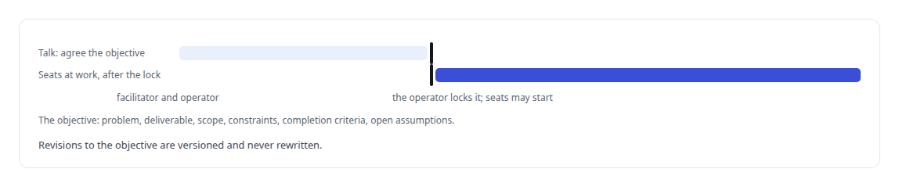
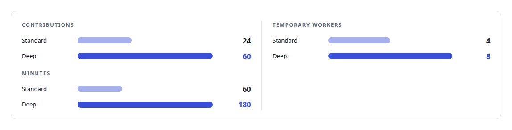
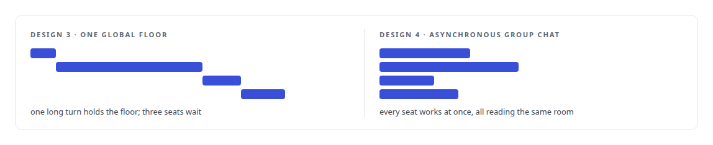
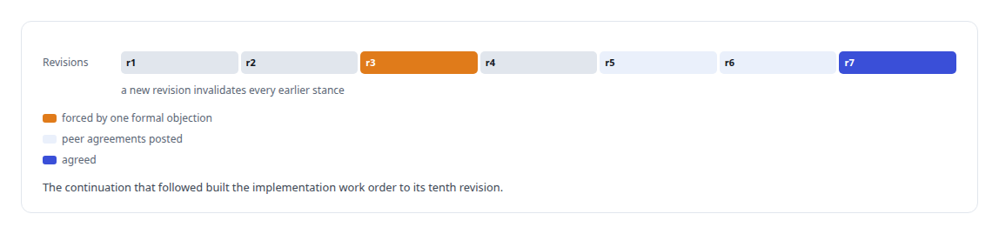

# Three councils I threw away

**Four designs for several models deliberating toward one plan, and why only the one that behaves like a real group conversation survived real use**

Canonical: https://coreyjames.ai/stories/three-councils-i-threw-away/  
Author: Corey James · Published: 2026-10-28 · Kind: story  
Systems: [Helix](https://github.com/coreyjames-ai/helix)  
Technologies: [Governed AI-assisted software engineering](https://github.com/coreyjames-ai/portfolio/tree/main/technologies/governed-ai-assisted-software-engineering) · [Idempotency, exactly-once effects and crash recovery](https://github.com/coreyjames-ai/portfolio/tree/main/technologies/idempotency-exactly-once-effects-and-crash-recovery) · [Mattermost](https://github.com/coreyjames-ai/portfolio/tree/main/technologies/mattermost) · [PostgreSQL](https://github.com/coreyjames-ai/portfolio/tree/main/technologies/postgresql) · [Rust](https://github.com/coreyjames-ai/portfolio/tree/main/technologies/rust)  
Skills: [multi-agent governance](https://github.com/coreyjames-ai/portfolio/tree/main/skills/multi-agent-governance) · [AI-assisted engineering methodology](https://github.com/coreyjames-ai/portfolio/tree/main/skills/ai-assisted-engineering-methodology) · [technical leadership of agent teams](https://github.com/coreyjames-ai/portfolio/tree/main/skills/technical-leadership-of-agent-teams) · [exactly-once delivery and crash recovery](https://github.com/coreyjames-ai/portfolio/tree/main/skills/exactly-once-delivery-and-crash-recovery)  


## Result

| Figure | What it measures |
| --- | --- |
| **9** | defects the first council surfaced in itself on its first real use |
| **7** | candidate revisions in one costing council before agreement |
| **21 of 24** | contribution slots committed when a mid-turn restart stalled a council |

## What was built

A council is Helix's answer to a question I kept running into: how do you get several strong models to deliberate toward a plan without one of them dominating, without a runaway loop, and with a human in control? I built it four times. The first three worked as software and failed as councils. All four protocols are still in the tree, because the rejections are where the judgment is.

## Opening a council

Every version opens the same way. The operator presses a council button in the chat composer, or chooses to invoke a council about a particular post or file. A builder collects the problem, the seats, and the budgets. Any fixed seat can be chosen, duplicates allowed, each with its own reasoning effort and an optional persona. The server resolves the scope from the channel mapping; the browser cannot assert one. A council started from a channel runs in that channel, one started from a thread runs in that thread, and one started from a direct message gets a private council channel tied to the same scope. A client request id makes a double click or a lost response harmless. The seats are added to the channel before launch, and a failed membership leaves the council unlaunched with the missing participant named.

No autonomous work starts until the objective is agreed. A facilitator talks with the operator and writes down a structured objective, and the operator locks it.



## First: a chair with the floor

The first design gave one seat the chair. It held a single visible floor and called the others in turn, with optional temporary workers for side investigations and a mandatory challenger. Synthesis closed with one stance per voting seat, agree, agree with reservation, object or abstain, and the computed outcome was one of unanimous, consensus with reservations, majority, no consensus, operator decision or challenge unavailable. The chair could not claim a stronger outcome than the stances allowed. Budgets came in presets, and a limit paused the council rather than forcing a shallow answer.



Its first real use was a multi-hour planning council on feature parity with a commercial video-meeting product. It produced a feasibility study and surfaced defects in the council itself.

## Second: a coordinator that fanned out

The fix made the chair a non-voting coordinator that decomposed the objective into parallel rounds and reconciled the results. It was implemented with database tests and put into use. Then I used it, and I rejected it in writing: what I had was a bounded parallel fan-out engine in which one coordinator assigns isolated work, receives private results, and controls which result reaches synthesis. Seat results were private. Only the coordinator could route. The dispatch contract had no peer relationship. Synthesis could bypass deliberation. The acceptance tests would have passed a set of independent monologues followed by one summary. That is agreement without deliberation, and it is worthless.


## Third: one floor, peer challenge

The third design put a deterministic conductor in charge of lifecycle, queue, floor and budget, and ended the facilitator's role at the objective. Seats got council-only tools: ask a seat, challenge a seat, request a revision, resolve an item, state a position. A challenge became a durable item delivered to its target with the exact source contribution, and the originator decided whether the answer resolved it. Synthesis was gated on every seat having opened, at least two seats having spoken twice, at least one challenge answered, every item closed and every seat ready, with readiness never inferred from prose. Then came proposal review, amendments, re-review and ratification of the exact revision.

Real use showed the flaw. A single global floor serialised everything. One long turn by one model blocked every other participant, and a council of strong models spent most of its time waiting.



## What survived: an asynchronous group chat

The final design removes the floor, the private assignments, the synthesis owner and the voting ceremony. Helix facilitates the objective dialogue and nothing more: it may restate and clarify, and it may not decompose, assign or author. On start, every selected seat runs at once, each in its own provider session with its own persona, all reading the same room, which is the shared transcript authority. A seat can post an interim finding, question or challenge without ending its turn, optionally notifying named peers. A busy seat gets one coalesced pending refresh, so there is no unbounded queue, and an operator post wakes every idle seat. Posts by seats become shared history and wake nobody unless the author names a peer.

Any seat may object to any other, and an objection must name the unresolved issue. Any seat may propose a candidate outcome, a post plus the files already in the room, and the proposal gets a revision number. Every substantive seat must post an exact agreement on that revision. A new revision invalidates earlier stances, and a missing, failed, abstaining or reservation-bearing seat does not count toward agreement. No chair rules. On unanimity the bridge closes the council atomically and posts a control message linking the outcome, with no model turn required, so a slow facilitator cannot delay it. Helix cannot declare consensus and cannot override an objection. Seats have no wall-clock deadline while they are doing observable work, one seat's failure never stops the others, and a restart recovers in place.

## What councils have produced

A finished council stays visible and offers a continuation, which opens an immutable next round with the same seats, room and scope. One continuation mode has the same council turn its outcome into a full work-order package for my governance platform, validated by the platform's own authoring command without being applied; the handoff is in [From a conversation to a work order](https://coreyjames.ai/stories/from-a-conversation-to-a-work-order).

Councils have produced the feasibility study above; a costing package for Helix's own activity, revised under per-seat votes as the figure below shows; a continuation that built the implementation work order for that package; and a planning continuation that reached its sixth revision with eight artifacts and agreement from three of four seats. The fourth stance was missing because a large prompt had been silently dropped by a vendor's terminal, which is how the transcript-proven delivery rule in [Several minds in one room](https://coreyjames.ai/stories/several-minds-in-one-room) came about.



One council stalled when a routine deployment restarted the provider services mid-turn: the committed contribution slots held, the three turns in flight were marked interrupted, and a budget pause was committed against work that was still running. I called it a self-induced infrastructure deadlock and fixed the restart and budget state machines rather than raising the budget.

## What this demonstrates

I exercise design judgment in real use, not on paper. Each rejected council, used for real planning, did something other than deliberate. The one that survived is the one that behaves like a group of colleagues in a room, closes only on exact unanimous agreement, and gives no model the power to rule.

I defined what a council must be, rejected my own designs after using them, and directed AI coding agents, a mix of frontier and open-source models, that implemented each version under my governance system.

> Each rejected council passed its tests.

## What was verified

Each line is a claim the canonical page supports, with the figure as the page states it.

- Consensus and deliberation protocols for AI agents: four council designs built and used, three rejected after real use, the survivor closing only on unanimous agreement with one revision.
- Defect discovery through real use: the first council surfaced 9 defects in itself on its first real use.
- Versioned agreement for AI planning: a costing council moved through 7 candidate revisions before agreement, each new revision invalidating earlier stances.
- Crash recovery in multi-agent sessions: a mid-turn restart left 21 of 24 contribution slots committed and the interrupted turns marked, with nothing lost.

## Related

- [Several minds in one room](https://github.com/coreyjames-ai/helix/tree/main/stories/several-minds-in-one-room) · https://coreyjames.ai/stories/several-minds-in-one-room/
- [From a conversation to a work order](https://github.com/coreyjames-ai/helix/tree/main/stories/from-a-conversation-to-a-work-order) · https://coreyjames.ai/stories/from-a-conversation-to-a-work-order/
- [Why long agent runs fail](https://github.com/coreyjames-ai/agentos/tree/main/stories/why-long-agent-runs-fail) · https://coreyjames.ai/stories/why-long-agent-runs-fail/

## Citation

Corey James. "Three councils I threw away." coreyjames.ai, 2026. https://coreyjames.ai/stories/three-councils-i-threw-away/

```bibtex
@misc{coreyjames-three-councils-i-threw-away,
  author = {Corey James},
  title = {Three councils I threw away},
  year = {2026},
  howpublished = {\url{https://coreyjames.ai/stories/three-councils-i-threw-away/}},
  note = {GitHub copy: https://github.com/coreyjames-ai/helix/tree/main/stories/three-councils-i-threw-away}
}
```

Part of [Helix](https://github.com/coreyjames-ai/helix) and [Corey James's portfolio](https://github.com/coreyjames-ai/portfolio) · site: https://coreyjames.ai/ · MCP server: https://coreyjames.ai/mcp · agent card: https://coreyjames.ai/.well-known/agent.json
