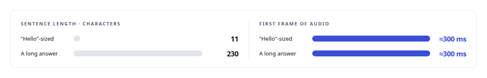
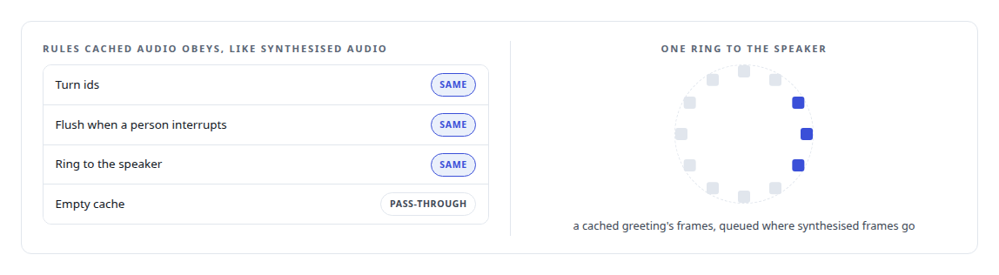
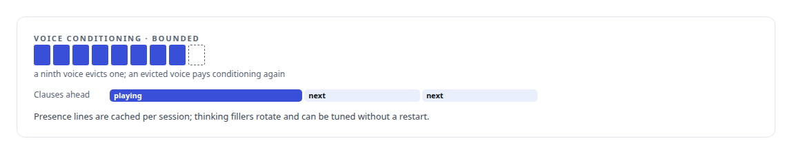

# Three hundred milliseconds of hello

**The lines an assistant says most, the greeting, the thinking fillers, the short acknowledgements, are pre-rendered per voice at session start and play in under a millisecond, through the same cancellation path as synthesised speech**

Canonical: https://coreyjames.ai/stories/three-hundred-milliseconds-of-hello/  
Author: Corey James · Published: 2026-10-28 · Kind: story  
DOI: https://doi.org/10.5281/zenodo.23735146 (this page is a chapter of the system's report)  
Systems: [Helix](https://github.com/coreyjames-ai/helix)  
Technologies: [Real-time audio pipeline engineering](https://github.com/coreyjames-ai/portfolio/tree/main/technologies/real-time-audio-pipeline-engineering) · [Rust](https://github.com/coreyjames-ai/portfolio/tree/main/technologies/rust)  
Skills: [real-time voice AI](https://github.com/coreyjames-ai/portfolio/tree/main/skills/real-time-voice-ai) · [AI-assisted engineering methodology](https://github.com/coreyjames-ai/portfolio/tree/main/skills/ai-assisted-engineering-methodology) · [inference serving architecture](https://github.com/coreyjames-ai/portfolio/tree/main/skills/inference-serving-architecture)  


## Result

| Figure | What it measures |
| --- | --- |
| **≈8 s** | added to session boot to fill the cache |
| **5.3 s** | to condition a voice the first time, nothing after |
| **8** | voices held in the bounded conditioning cache |

## What was built

The streaming synthesiser in [Building the streaming my speech model did not ship](https://coreyjames.ai/stories/building-the-streaming-my-speech-model-did-not-ship) produces its first frame of audio about 300 milliseconds after it is given a sentence, and that figure is flat: eleven characters or two hundred and thirty, the first frame costs the same. For a long answer it is a fine price. For "Hello", "One moment" and "Let me check", which a voice assistant says many times an hour, it is a tax on the words that most need to be instant.



## The opener cache

At the start of a session the engine renders each persona's greeting, its thinking fillers and its short acknowledgements through the streaming synthesiser and keeps the audio in memory, keyed by voice and exact text. The first line of a session is synthesised on the spot, so the session never waits silent for the cache to fill.

A guard test makes sure the boot order cannot leave the cache half-filled.




## The other caches

The synthesiser conditions each voice from a reference recording, and that conditioning is cached too, so a room with many personas pays the cost once per voice and an evicted voice pays it again.



## What this demonstrates

I know which words carry the latency. The cache is small and the mechanism is ordinary; the judgment was in measuring that the first frame is flat and noticing which lines are repeated.

The cache design and the rule that it shares the synthesis path were mine; AI coding agents, a mix of frontier and open-source models, implemented it under my governance system.

> Cached audio has to obey every rule synthesised audio obeys.

## What was verified

Each line is a claim the canonical page supports, with the figure as the page states it.

- Latency engineering for voice AI: the lines an assistant says most pre-rendered per voice at session start, so they skip the roughly 300 ms a synthesiser takes to its first frame.
- Caching design for real-time audio: cached audio held to every rule synthesised audio obeys, filled by about 8 s added to session boot.
- Bounded caches: voice conditioning cached for 8 voices, 5.3 s the first time and nothing after.

## Related

- [Building the streaming my speech model did not ship](https://github.com/coreyjames-ai/helix/tree/main/stories/building-the-streaming-my-speech-model-did-not-ship) · https://coreyjames.ai/stories/building-the-streaming-my-speech-model-did-not-ship/
- [From two seconds to under one](https://github.com/coreyjames-ai/helix/tree/main/stories/from-two-seconds-to-under-one) · https://coreyjames.ai/stories/from-two-seconds-to-under-one/
- [The same brain, typed or spoken](https://github.com/coreyjames-ai/helix/tree/main/stories/the-same-brain-typed-or-spoken) · https://coreyjames.ai/stories/the-same-brain-typed-or-spoken/

## Citation

Corey James. "Three hundred milliseconds of hello." coreyjames.ai, 2026. https://coreyjames.ai/stories/three-hundred-milliseconds-of-hello/ In: the Helix technical report, doi:10.5281/zenodo.23735146.

```bibtex
@misc{coreyjames-three-hundred-milliseconds-of-hello,
  author = {Corey James},
  title = {Three hundred milliseconds of hello},
  year = {2026},
  howpublished = {\url{https://coreyjames.ai/stories/three-hundred-milliseconds-of-hello/}},
  note = {GitHub copy: https://github.com/coreyjames-ai/helix/tree/main/stories/three-hundred-milliseconds-of-hello},
  doi = {10.5281/zenodo.23735146}
}
```

Part of [Helix](https://github.com/coreyjames-ai/helix) and [Corey James's portfolio](https://github.com/coreyjames-ai/portfolio) · site: https://coreyjames.ai/ · MCP server: https://coreyjames.ai/mcp · agent card: https://coreyjames.ai/.well-known/agent.json
